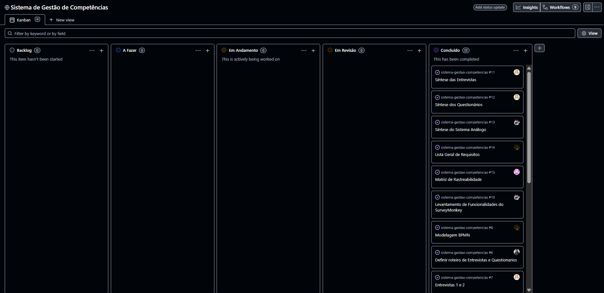

# Planejamento

Planejamento das atividades da 1ª etapa em formato Kanban, mantido no GitHub Projects.

**Kanban:** [GitHub Project](https://github.com/users/A4thu4/projects/6)

Colunas: Backlog, A fazer, Em andamento, Em revisão, Concluído. Cada cartão é uma issue com responsável e marco (milestone).

| Arquivo            | Descrição                                          | Status    |
|--------------------|----------------------------------------------------|-----------|
| kanban-marco-1.png | Captura do quadro em 07/10                         | Concluído |
| kanban-marco-2.png | Captura do quadro em 13/10                         | Concluído |
| kanban-final.png   | Captura do quadro em 20/10 (versão para impressão) | Concluído |

Responsável: Arthur Mamedes Borges (issues #1 e #2)

## Quadro final (20/10)

Todas as 17 issues da 1ª etapa na coluna Concluído.

