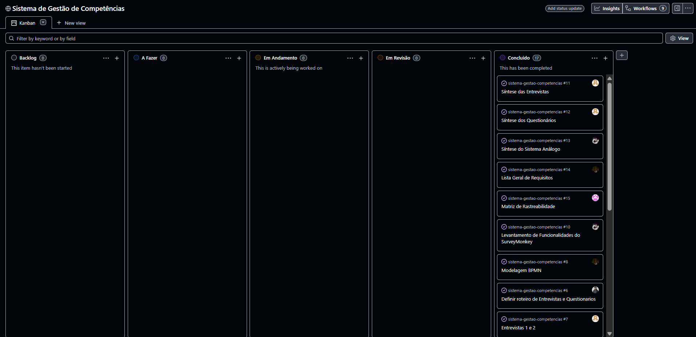

# Planejamento

Planejamento das atividades da 1ª etapa e do Marco 4 em formato Kanban, mantido no GitHub Projects.

**Kanban:** [GitHub Project](https://github.com/users/A4thu4/projects/6)

Colunas: Backlog, A fazer, Em andamento, Em revisão, Concluído. Cada cartão é uma issue com responsável e marco (milestone).

| Arquivo            | Descrição                                          | Status    |
|--------------------|----------------------------------------------------|-----------|
| kanban-marco-1.png | Captura do quadro em 07/10                         | Concluído |
| kanban-marco-2.png | Captura do quadro em 13/10                         | Concluído |
| kanban-final.png   | Captura do quadro em 20/10 (versão para impressão) | Concluído |

Responsável: Arthur Mamedes Borges (issues #1 e #2)

## Quadro final (20/10)

Todas as 17 issues da 1ª etapa na coluna Concluído.

## Marco 4 (22/10 a 19/11)

Mesmo quadro e mesmas colunas. As issues #23 a #36 estão divididas em quatro milestones semanais, para o grupo ter pontos de controle como na 1ª etapa.

| Milestone | Prazo | Issues | Entrega |
|-----------|-------|--------|---------|
| Marco 4.1 | 29/10 | #23, #24, #25 | Estrutura, Documento Visão e diagrama de casos de uso |
| Marco 4.2 | 05/11 | #26 a #31 | Casos de uso completos (1 por integrante) e resumidos |
| Marco 4.3 | 12/11 | #32, #33, #34 | Protótipos, ERS IEEE 830 e matriz vertical/horizontal |
| Marco 4.4 | 19/11 | #35, #36 | Revisão cruzada, impressão e entrega |

Ordem de dependência: Visão → atores e diagrama → casos de uso → protótipos → ERS e matriz → revisão.

Responsáveis por issue: ver a tabela de artefatos no [README principal](../../README.md#artefatos-de-entrega).

O andamento das issues #23 a #36 pode ser conferido no [quadro do GitHub Project](https://github.com/users/A4thu4/projects/6).

## Marco 5 — Parte III (16/11 a 03/12)

Terceira parte do trabalho: documento único de Arquitetura e Desenho Detalhado, na estrutura do [enunciado da Parte III](../15-documento-arquitetura/enunciado-parte-iii.md) (seções 1 a 5, com o modelo C4 adaptado em quatro níveis). **Entrega do PDF e apresentação: 03 e 04/12.** Mesmo quadro e mesmas colunas. A estrutura combinada em 16/11 foi realinhada ao enunciado em 19/11: entraram a seção 4 (ambiente Web), o DImp, o BPMN proposto, os UC-06 a UC-10 completos com telas, o DDC, o EOBD e os contratos de operação; saíram o Projeto do Banco de Dados separado e a seção de coesão e padrões (que virou mecanismo na seção 3.2).

| Milestone | Prazo | Issues | Entrega |
|-----------|-------|--------|---------|
| Marco 5.1 | 23/11 | #50 a #54, #61, #67 a #74 | Seções 1 a 4; DImp, DPN, DCdu, DPac; UC-06 a UC-10 com telas; ajustes das telas; DCD |
| Marco 5.2 | 29/11 | #55 a #60, #62 | DCmp, DSeq e DCla de cada pacote; DDC e EOBD; 3 DSeq de operação e contratos CO-01 a CO-03 |
| Marco 5.3 | 02/12 | #64, #65 | Revisão cruzada (30/11 e 01/12), Apêndice C, referências, apêndices e PDF; entrega em 03/12 |
| Protótipo | a confirmar | #63 e a parte de implementação de #55 a #60 | Código em Spring Boot; fora do PDF da Parte III |

**Divisão:** cada item do documento tem um autor e um revisor diferentes; a tabela completa (IT-01 a IT-36) está no [README do Documento de Arquitetura](../15-documento-arquitetura/README.md#autoria-e-revisão-dos-itens-de-informação).

| Integrante | Autor de | Revisor de |
|------------|----------|------------|
| Arthur Mamedes Borges | Cabeçalho e tabela de autoria, DImp, DCdu, DPac (#53); UC-05; UC-09 e TL-09 (#72); `privacidade` e `compartilhado` (#60); referências, apêndices e PDF (#64, #65) | Introdução; racional 3.2; UC-04; UC-08; TL-01 a TL-05; `resultados` |
| Gabriel Araújo Caetano | Seções 1 e 2 (#51); seções 4.1 a 4.3 (#61); UC-03; UC-08 e TL-08 (#71); `avaliacoes` e CO-02 (#58) | Cabeçalho; RNF 3.1; DImp; UC-01 e UC-02; UC-10; `ciclos`; CO-03; apêndices A e B |
| Lorenzo Oliveira Maciel | Seção 3 (#52); seções 4.4 e 4.5 (#67); UC-04; UC-06 e TL-06 (#69); `resultados` e CO-03 (#59) | Seção 2; DCdu; UC-05; UC-07; `identidade`; CO-01; referências |
| Rikelmy Andrade | DPN proposto (#68); UC-10 e TL-10 (#73); ajustes TL-01 a TL-05 (#74); `identidade` (#55); DDC e EOBD (#62) | Seção 4; UC-06; `competencias`; `privacidade`; DCD; CO-02; Apêndice C |
| José Eduardo | UC-01 e UC-02; UC-07 e TL-07 (#70); DCD (#54); `competencias` (#56); `ciclos` e CO-01 (#57) | DPN; DPac; UC-03; UC-09; `avaliacoes`; DDC; EOBD |

Ordem de dependência: seções 1 a 4 e níveis 1 e 2 (Marco 5.1) → níveis 3 e 4 (Marco 5.2) → revisão cruzada e PDF (Marco 5.3). Os nomes de pacotes, componentes, classes e tabelas dos diagramas são os mesmos do código do protótipo.
