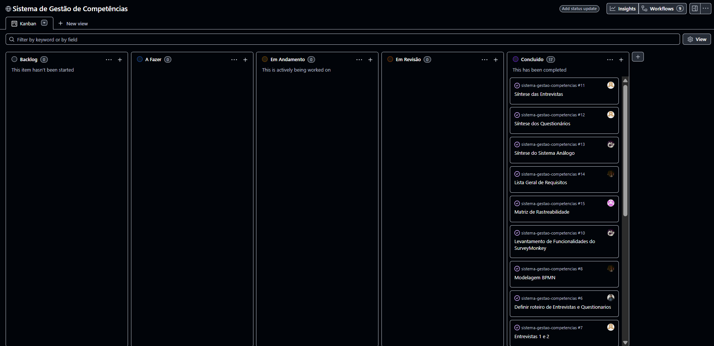

# Planejamento

Planejamento das atividades da 1ª etapa em formato Kanban, mantido no GitHub Projects.

**Kanban:** [GitHub Project](https://github.com/users/A4thu4/projects/6)

Colunas: Backlog, A fazer, Em andamento, Em revisão, Concluído. Cada cartão é uma issue com responsável e marco (milestone).

| Arquivo            | Descrição                                          | Status    |
|--------------------|----------------------------------------------------|-----------|
| kanban-marco-1.png | Captura do quadro em 07/10                         | Concluído |
| kanban-marco-2.png | Captura do quadro em 13/10                         | Concluído |
| kanban-final.png   | Captura do quadro em 20/10 (versão para impressão) | Concluído |

Responsável: Arthur Mamedes Borges (issues #1 e #2)

## Quadro final (20/10)

Todas as 17 issues da 1ª etapa na coluna Concluído.

## Marco 4 (22/10 a 19/11)

Mesmo quadro e mesmas colunas. As issues #23 a #36 estão divididas em quatro milestones semanais, para o grupo ter pontos de controle como na 1ª etapa.

| Milestone | Prazo | Issues | Entrega |
|-----------|-------|--------|---------|
| Marco 4.1 | 29/10 | #23, #24, #25 | Estrutura, Documento Visão e diagrama de casos de uso |
| Marco 4.2 | 05/11 | #26 a #31 | Casos de uso completos (1 por integrante) e resumidos |
| Marco 4.3 | 12/11 | #32, #33, #34 | Protótipos, ERS IEEE 830 e matriz vertical/horizontal |
| Marco 4.4 | 19/11 | #35, #36 | Revisão cruzada, impressão e entrega |

Ordem de dependência: Visão → atores e diagrama → casos de uso → protótipos → ERS e matriz → revisão.

Responsáveis por issue: ver a tabela de artefatos no [README principal](../../README.md#artefatos-de-entrega).

A captura do quadro do Marco 4 (`kanban-marco-4.png`) é feita depois do merge da organização final, com todas as issues #23 a #36 na coluna Concluído.
