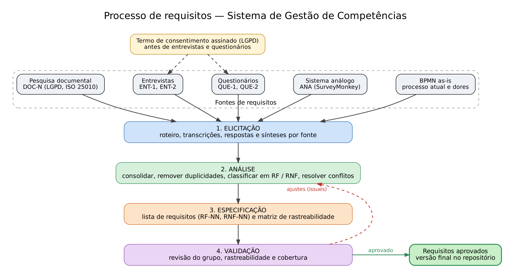

# Processo de requisitos

Processo de engenharia de requisitos adotado pelo grupo no **Sistema de Gestão de Competências** (avaliação chefe–colaborador, por pares e 360º). O processo segue quatro etapas: elicitação, análise, especificação e validação. As etapas se repetem em ciclos curtos, de acordo com os marcos do projeto.

## 1. Visão geral

| Etapa         | Objetivo                                                    | Entrada                          | Saída                                               |
|---------------|-------------------------------------------------------------|----------------------------------|-----------------------------------------------------|
| Elicitação    | Descobrir necessidades junto às fontes                      | Escopo do projeto, fontes        | Transcrições, respostas, sínteses por fonte         |
| Análise       | Consolidar, remover duplicidades, resolver conflitos        | Sínteses por fonte               | Requisitos consolidados e classificados             |
| Especificação | Escrever os requisitos de forma clara e rastreável          | Requisitos consolidados          | Lista de requisitos (`RF-NN`, `RNF-NN`) e matriz    |
| Validação     | Conferir se os requisitos são corretos, completos e viáveis | Lista de requisitos e matriz     | Requisitos revisados e aprovados pelo grupo         |

## 2. Etapas e técnicas

### 2.1 Elicitação

| Técnica               | Fonte (ID)       | Descrição                                                                         | Local                                    |
|-----------------------|------------------|-----------------------------------------------------------------------------------|------------------------------------------|
| Leitura do escopo     | `ESC`            | Funcionalidades mínimas e restrições definidas no enunciado do projeto            | [00-escopo](../00-escopo)                |
| Pesquisa documental   | `DOC-N`          | Leitura de leis e normas aplicáveis (LGPD, ISO/IEC 25010)                         | [03-pesquisa-documental](../03-pesquisa-documental) |
| Entrevistas           | `ENT-1`, `ENT-2` | Entrevistas semiestruturadas com roteiro-guia, transcritas e sintetizadas         | [04-entrevistas](../04-entrevistas)      |
| Questionários         | `QUE-1`, `QUE-2` | Questionário aplicado a pessoas diferentes das entrevistadas                      | [05-questionarios](../05-questionarios)  |
| Análise de sistema análogo | `ANA`       | Estudo das funcionalidades do SurveyMonkey relacionadas a avaliação e feedback    | [06-sistema-analogo](../06-sistema-analogo) |
| Modelagem de processo | —                | BPMN do processo atual (as-is) para identificar as dores                          | [07-bpmn](../07-bpmn)                    |

Antes de entrevistas e questionários, cada participante assina o termo de consentimento para coleta e uso de dados pessoais (LGPD), arquivado em [anexos](../anexos).

### 2.2 Análise

- Cada fonte gera uma **síntese** com os requisitos identificados.
- As sínteses são reunidas em uma única lista, removendo duplicidades e agrupando requisitos semelhantes.
- Cada requisito é classificado como **funcional (RF)** ou **não funcional (RNF)**.
- Conflitos entre fontes são discutidos em reunião do grupo e a decisão é registrada.
- As dores do BPMN são usadas para checar se cada problema do processo atual tem requisito correspondente.

### 2.3 Especificação

- Os requisitos são escritos na [lista de requisitos](../08-requisitos), com identificador, descrição, tipo e prioridade.
- Cada requisito é escrito em uma frase objetiva e verificável (por exemplo: "O sistema deve permitir...").
- A [matriz de rastreabilidade](../08-requisitos) liga cada requisito às fontes que o originaram.
- **Regra:** todo requisito aparece na matriz ligado a pelo menos uma fonte.

### 2.4 Validação

- **Revisão pelo grupo:** todos os integrantes leem a lista e conferem clareza, ausência de ambiguidade e de contradições.
- **Conferência de rastreabilidade:** nenhum requisito sem fonte e nenhuma fonte sem requisito derivado.
- **Conferência de cobertura:** as dores do BPMN e os pontos da LGPD e da ISO/IEC 25010 estão cobertos.
- Ajustes pedidos na revisão são registrados em issues e resolvidos antes da entrega.

## 3. Papéis

| Papel                         | Responsabilidade                                                                  |
|-------------------------------|-----------------------------------------------------------------------------------|
| Gerente de Projeto            | Coordenar o Kanban, os marcos e a integração dos artefatos (Arthur Mamedes Borges) |
| Responsável pela pesquisa documental | Levantar leis e normas e derivar requisitos (`DOC-N`)                      |
| Responsável pelas entrevistas | Roteiro, condução, transcrição e síntese (`ENT-N`)                                |
| Responsável pelos questionários | Modelo, aplicação, respostas e síntese (`QUE-N`)                                |
| Responsável pelo sistema análogo | Descrição das funcionalidades e síntese (`ANA`)                                |
| Responsável pelo BPMN         | Modelo do processo atual e lista de dores                                         |
| Responsável pelos requisitos  | Lista de requisitos e matriz de rastreabilidade                                   |
| Todos os integrantes          | Revisar os artefatos na validação                                                 |

Os responsáveis de cada artefato estão indicados no README de cada pasta de `docs/`.

## 4. Padrão de identificadores

| Tipo                    | Padrão   | Exemplo  |
|-------------------------|----------|----------|
| Requisito funcional     | `RF-NN`  | `RF-01`  |
| Requisito não funcional | `RNF-NN` | `RNF-01` |
| Entrevista              | `ENT-N`  | `ENT-1`  |
| Questionário            | `QUE-N`  | `QUE-1`  |
| Sistema análogo         | `ANA`    | `ANA`    |
| Pesquisa documental     | `DOC-N`  | `DOC-1`  |

## 5. Gestão do processo

- **Versionamento:** todos os artefatos ficam no repositório, na pasta `docs/`, com commits no padrão `tipo: descrição`.
- **Planejamento:** as atividades são acompanhadas no Kanban (GitHub Projects), com uma issue por atividade, responsável e marco.
- **Dados pessoais:** nome, função e telefone de entrevistados e respondentes ficam apenas nos arquivos de transcrição e de respostas.

## 6. Diagrama do fluxo

