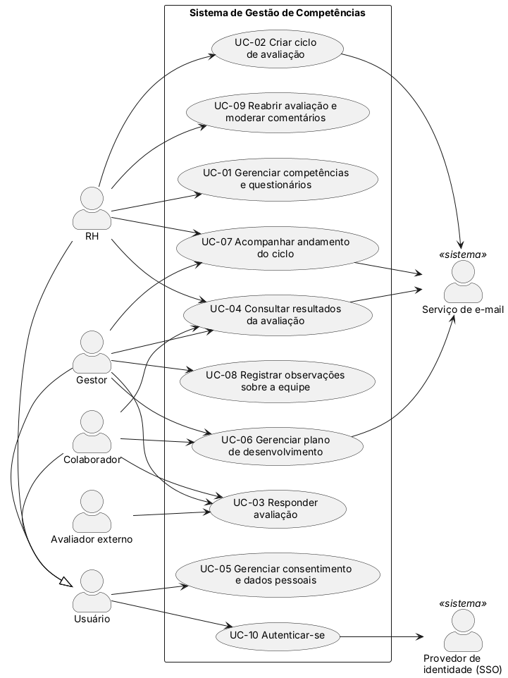

# Casos de uso

Atores, diagrama e descrição dos casos de uso essenciais, no modelo do capítulo 6 do Larman. Regra do enunciado: **pelo menos 1 caso de uso completo por integrante**.

| Arquivo | Descrição | Status |
|---------|-----------|--------|
| modelo-caso-de-uso.md | Modelo do formato completo (*fully dressed*) | Concluído |
| diagrama-casos-de-uso.puml | Fonte do diagrama (PlantUML) | Concluído |
| diagrama-casos-de-uso.png | Diagrama exportado | Concluído |
| UC-NN-*.md | Um arquivo por caso de uso completo | Em andamento (UC-01, UC-03, UC-04 e UC-05 concluídos) |

## Atores

Identificados a partir dos usuários e serviços externos do [Documento Visão](../10-documento-visao/documento-visao.md) (seções 3.2 e 4.1).

| Ator | Tipo | Descrição |
|------|------|-----------|
| Usuário | Principal (abstrato) | Qualquer pessoa com conta no sistema; generaliza RH, Gestor e Colaborador |
| RH | Principal | Mantém competências e questionários, cria e acompanha ciclos, libera resultados e modera comentários |
| Gestor | Principal | Avalia a equipe, registra observações, acompanha o ciclo e conduz o plano de desenvolvimento |
| Colaborador | Principal | Faz a autoavaliação, avalia pares e o líder, consulta os próprios resultados e registra o progresso das metas |
| Avaliador externo | Principal | Cliente, fornecedor ou parceiro que responde por link individual, sem conta (`RF-34`) |
| Serviço de e-mail | Suporte | Envia convites, lembretes e notificações (`RF-12`, `RF-24`, `RF-28`) |
| Provedor de identidade (SSO) | Suporte | Autentica com a conta corporativa, quando disponível (`RF-32`) |

## Casos de uso essenciais

Derivados dos objetivos no nível do usuário (seção 3.5 do Documento Visão), no nível de processo elementar de negócio: uma pessoa, uma sessão, um resultado de valor.

| ID | Caso de uso | Ator principal | Formato | Requisitos | Responsável |
|----|-------------|----------------|---------|------------|-------------|
| UC-01 | [Gerenciar competências e questionários](UC-01-gerenciar-competencias-questionarios.md) | RH | **Completo** | `RF-01` a `RF-07`, `RNF-13` | José Eduardo |
| UC-02 | Criar ciclo de avaliação | RH | **Completo** | `RF-08` a `RF-10`, `RF-12`, `RF-34` | Rikelmy Andrade |
| UC-03 | [Responder avaliação](UC-03-responder-avaliacao.md) | Gestor, Colaborador, Avaliador externo | **Completo** | `RF-06`, `RF-11`, `RF-14` a `RF-18`, `RF-25`, `RNF-01`, `RNF-08` | Gabriel Araújo Caetano |
| UC-04 | [Consultar resultados da avaliação](UC-04-consultar-resultados.md) | Colaborador, Gestor, RH | **Completo** | `RF-19` a `RF-24`, `RF-26`, `RNF-01` a `RNF-03`, `RNF-05`, `RNF-12` | Lorenzo Oliveira Maciel |
| UC-05 | [Gerenciar consentimento e dados pessoais](UC-05-gerenciar-consentimento.md) | Usuário | **Completo** | `RF-29`, `RF-30`, `RNF-06`, `RNF-09` | Arthur Mamedes Borges |
| UC-06 | Gerenciar plano de desenvolvimento | Gestor, Colaborador | Resumido | `RF-27`, `RF-28` | A definir |
| UC-07 | Acompanhar andamento do ciclo | RH, Gestor | Resumido | `RF-12`, `RF-13` | A definir |
| UC-08 | Registrar observações sobre a equipe | Gestor | Resumido | `RF-17` | A definir |
| UC-09 | Reabrir avaliação e moderar comentários | RH | Resumido | `RF-16`, `RF-22`, `RNF-05` | A definir |
| UC-10 | Autenticar-se | Usuário | Resumido | `RF-31` a `RF-33` | A definir |

Os cinco casos completos (UC-01 a UC-05) cobrem as funcionalidades centrais do escopo; os resumidos (UC-06 a UC-10) completam a cobertura dos requisitos. Cada integrante escreve um caso completo: UC-01 na issue #26, UC-02 na #27, UC-03 na #28, UC-04 na #29 e UC-05 na #30.

### Cobertura dos requisitos funcionais

Todos os 34 requisitos funcionais da [lista geral](../08-requisitos/lista-requisitos.md) estão ligados a pelo menos um caso de uso:

| Característica (Visão) | Requisitos | Casos de uso |
|------------------------|------------|--------------|
| CAR-01 Competências e questionários | `RF-01` a `RF-07` | UC-01, UC-03 |
| CAR-02 Ciclos de avaliação | `RF-08` a `RF-13`, `RF-34` | UC-02, UC-03, UC-07 |
| CAR-03 Preenchimento | `RF-14` a `RF-18` | UC-03, UC-08, UC-09 |
| CAR-04 Resultados e análise | `RF-19` a `RF-25` | UC-03, UC-04, UC-09 |
| CAR-05 Acompanhamento e desenvolvimento | `RF-26` a `RF-28` | UC-04, UC-06 |
| CAR-06 Acesso e LGPD | `RF-29` a `RF-33` | UC-05, UC-10 |

Os requisitos não funcionais transversais (`RNF-04`, `RNF-07`, `RNF-10`, `RNF-11`) valem para todos os casos de uso e não são ligados a um caso específico.

## Diagrama de casos de uso

Fonte em [diagrama-casos-de-uso.puml](diagrama-casos-de-uso.puml). Para regenerar a imagem: `java -jar plantuml.jar -tpng diagrama-casos-de-uso.puml`.

## Casos de uso resumidos

Formato resumido (*brief*, Larman cap. 6): um parágrafo com o cenário principal de sucesso. Os casos completos (UC-01 a UC-05) ficam em arquivos próprios.

### UC-06 Gerenciar plano de desenvolvimento

**Ator principal:** Gestor, Colaborador · **Requisitos:** `RF-27`, `RF-28`

Depois que o resultado do ciclo é liberado, o gestor abre o plano de desenvolvimento do colaborador e, junto com ele, registra as metas, cada uma ligada a uma competência (por exemplo, as de menor média no ciclo), com as ações previstas (como um curso), o prazo e a situação. O sistema salva o plano no histórico do colaborador. A cada trimestre, o sistema envia por e-mail um lembrete ao gestor e ao colaborador para revisarem as metas; o colaborador registra o progresso das ações, os dois atualizam a situação de cada meta e o sistema guarda a data de cada atualização.

### UC-07 Acompanhar andamento do ciclo

**Ator principal:** RH, Gestor · **Requisitos:** `RF-12`, `RF-13`

Com um ciclo aberto, o RH acessa o painel de andamento e vê, para toda a organização, as avaliações respondidas e pendentes por avaliador; o gestor acessa o mesmo painel limitado à sua equipe direta. O usuário identifica quem ainda tem respostas pendentes e cobra esses avaliadores. Enquanto isso, o sistema envia por e-mail os lembretes automáticos aos pendentes antes do encerramento e atualiza o painel à medida que as respostas são enviadas.

### UC-08 Registrar observações sobre a equipe

**Ator principal:** Gestor · **Requisitos:** `RF-17`

Ao longo do ano, sempre que presencia um fato relevante, o gestor seleciona um membro da sua equipe e registra uma observação, indicando se é um ponto positivo ou de melhoria e descrevendo o fato. O sistema grava a observação com a data e a mantém em uma lista cronológica por colaborador. Quando o gestor responde à avaliação desse colaborador (UC-03), o sistema exibe as observações do período para que a avaliação não dependa só da memória dos últimos meses.

### UC-09 Reabrir avaliação e moderar comentários

**Ator principal:** RH · **Requisitos:** `RF-16`, `RF-22`, `RNF-05`

Um avaliador pede ao RH para corrigir uma avaliação que já enviou. O RH localiza a avaliação, informa o motivo e confirma a reabertura; o sistema volta a avaliação para preenchimento, permite que o avaliador a altere e envie de novo e registra a reabertura no log de auditoria (usuário, data, hora e motivo). Na moderação, o RH revisa os comentários das perguntas abertas de um ciclo, que aparecem sem a identificação do autor (`RNF-01`), oculta um comentário ofensivo informando o motivo e o sistema deixa de exibi-lo nos resultados, registrando também essa ação no log de auditoria.

### UC-10 Autenticar-se

**Ator principal:** Usuário · **Requisitos:** `RF-31` a `RF-33`

O usuário acessa o sistema e informa suas credenciais individuais ou, quando o login corporativo está disponível, escolhe entrar com a conta da empresa e é redirecionado ao provedor de identidade (SSO). O sistema valida a autenticação, identifica o perfil do usuário (RH, gestor ou colaborador) e exibe a página inicial apenas com as funcionalidades permitidas a esse perfil. No primeiro acesso, antes da página inicial, o sistema apresenta o termo de consentimento (UC-05). O avaliador externo não passa por este caso de uso: ele responde pelo link individual recebido por e-mail (`RF-34`).

## Convenções

- Arquivo: `UC-NN-nome-curto.md`, a partir de [modelo-caso-de-uso.md](modelo-caso-de-uso.md).
- Casos de uso derivados dos objetivos no nível do usuário do [Documento Visão](../10-documento-visao/documento-visao.md).
- Casos de uso no nível de **processo elementar de negócio** (Larman): uma pessoa, um lugar, uma sessão, resultado de valor.
- Cada caso de uso cita os `RF`/`RNF` que cobre; essas ligações alimentam a [matriz vertical](../14-rastreabilidade/matriz-vertical.md).

Responsável: Arthur Mamedes Borges (issue #25)
