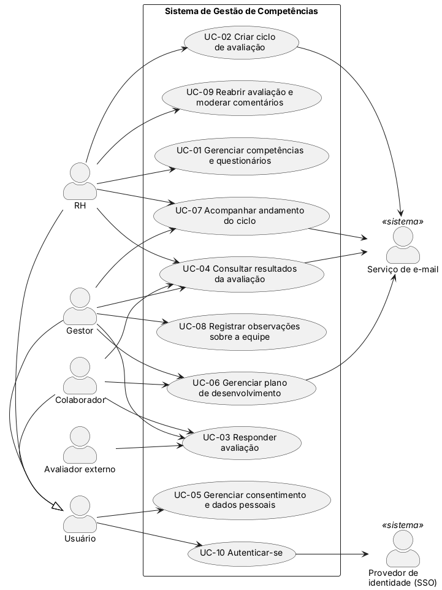

# Especificação de Requisitos de Software — Sistema de Gestão de Competências

> Estrutura da IEEE 830 (organização dos requisitos específicos por característica do sistema). Os identificadores seguem as convenções do [README](../../README.md): `RF-NN` e `RNF-NN` (requisitos), `CAR-NN` (característica do Documento Visão), `UC-NN` (caso de uso) e `Q-NN` (questão em aberto, [Apêndice B](#apêndice-b--questões-em-aberto-e-alterações-propostas)).

| Versão | Data | Autor | Alteração |
|--------|------|-------|-----------|
| 0.1 | 22/10/2026 | Arthur Mamedes Borges | Estrutura inicial |
| 1.0 | 12/11/2026 | José Eduardo | Primeira versão completa |

## 1. Introdução

### 1.1 Propósito

Este documento especifica os requisitos do Sistema de Gestão de Competências, uma aplicação web para planejar, aplicar e analisar avaliações de competências e acompanhar o desenvolvimento das pessoas ao longo do tempo. Ele reúne em um só lugar os 47 requisitos levantados na 1ª etapa (34 funcionais e 13 não funcionais), o [Documento Visão](../10-documento-visao/documento-visao.md) e os [casos de uso](../11-casos-de-uso).

| Público-alvo | Como usa este documento |
|--------------|-------------------------|
| Equipe | Referência única do que o sistema deve fazer, para os protótipos, as matrizes de rastreabilidade e a revisão final. |
| Professora | Avaliar a especificação e orientar o que melhorar; o [Apêndice B](#apêndice-b--questões-em-aberto-e-alterações-propostas) reúne as questões que dependem de orientação. |
| Futuros desenvolvedores | Base para o projeto, a implementação e os testes, com um critério de verificação para cada requisito não funcional. |

O documento segue o modelo IEEE 830, pedido na disciplina. O enunciado aceita também uma EOR (Especificação de Objetivos e Requisitos); como o grupo não recebeu um modelo de EOR, ela não foi produzida, e a confirmação de que a IEEE 830 basta é a questão `Q-19` do Apêndice B.

### 1.2 Escopo

**Produto:** Sistema de Gestão de Competências, aplicação web que substitui o processo atual de avaliação, feito em planilhas enviadas por e-mail, e atende o RH, os gestores e os colaboradores de uma organização. Resumo do [Documento Visão](../10-documento-visao/documento-visao.md).

**O que o sistema faz**

| Característica | Funções |
|----------------|---------|
| `CAR-01` | Catálogo de competências técnicas e comportamentais e questionários por cargo, com escala de notas e perguntas abertas, configuráveis pelo RH sem alteração de código. |
| `CAR-02` | Ciclos de avaliação com várias fontes de feedback (chefe–colaborador, autoavaliação, pares, 360º e avaliadores externos), com convites e lembretes por e-mail. |
| `CAR-03` | Apoio ao preenchimento: salvamento automático, aviso de campos obrigatórios, observações do gestor ao longo do ano e resultado do ciclo anterior. |
| `CAR-04` | Consolidação automática dos resultados, painéis, relatórios por equipe e por área e exportação em PDF e Excel. |
| `CAR-05` | Histórico dos ciclos e plano de desenvolvimento, com metas, prazos e lembretes trimestrais. |
| `CAR-06` | Acesso por perfil, anonimato das respostas de pares, subordinados e externos, termo de consentimento, direitos do titular e log de auditoria (LGPD). |

**O que o sistema não faz**

| Fora do escopo | Motivo ou referência |
|----------------|----------------------|
| Integração obrigatória com outros sistemas da organização | Depende apenas de um serviço de e-mail e, quando disponível, de um provedor de identidade corporativa (Documento Visão, 4.1). |
| Aplicativo móvel na primeira versão | A interface web é responsiva; o aplicativo é perspectiva futura (`R-01`). |
| Cadastro de pessoas, cargos e estrutura de equipe | Nenhum requisito define a origem desses dados (`Q-01`). |
| Condução da conversa de feedback entre gestor e colaborador | O sistema fornece resultados, histórico e plano de metas para apoiá-la. |
| Modelo comercial | Projeto acadêmico, sem modelo comercial definido (Documento Visão, 4.3). |

**Benefícios** (Documento Visão, 4.2)

| Benefício | Para quem |
|-----------|-----------|
| Fechar o ciclo sem as cerca de três semanas de consolidação manual | RH |
| Feedback de várias fontes, com anonimato | Gestor e colaborador |
| Avaliações comparáveis, porque os níveis da escala são descritos | Todos os perfis |
| Decisões de pessoas baseadas em dados e em histórico | Diretoria e RH |
| Feedback que vira plano de desenvolvimento acompanhado | Gestor e colaborador |
| Tratamento de dados pessoais em conformidade com a LGPD | Organização e titulares |

### 1.3 Definições, acrônimos e abreviações

| Termo | Definição |
|-------|-----------|
| Ciclo de avaliação | Período, com data de abertura e de encerramento, em que um conjunto de pessoas é avaliado com os questionários definidos pelo RH. Hoje é anual. |
| Avaliação 360º | Avaliação que reúne, sobre a mesma pessoa, a visão do chefe, a autoavaliação, a dos pares e a dos subordinados quando ela é líder. |
| Competência | Conhecimento, habilidade ou comportamento avaliado, técnico ou comportamental, com nome e descrição. |
| Questionário | Conjunto de perguntas agrupadas por competência, destinado a um cargo, com escala de notas e perguntas abertas. |
| Escala de notas | Valores de 1 a 5 ou de 1 a 10, com uma descrição para cada nível. |
| Avaliado | Pessoa cujas competências são avaliadas em um ciclo. |
| Avaliador | Pessoa que responde à avaliação de um avaliado: chefe, par, subordinado, o próprio avaliado (autoavaliação) ou avaliador externo. |
| Relação | Vínculo do avaliador com o avaliado em uma avaliação (chefe, par, subordinado, autoavaliação ou externo). |
| Avaliador externo | Cliente, fornecedor ou parceiro convidado para um ciclo, que responde por link individual, sem conta no sistema. |
| Anonimato | Garantia de que a autoria das respostas de pares, subordinados e externos não é revelada a nenhum perfil, inclusive o RH. |
| Plano de desenvolvimento | Conjunto de metas ligadas a competências, com ações, prazo e situação, acompanhado após o ciclo. |
| Titular | Pessoa a quem se referem os dados pessoais tratados pelo sistema. |
| Encarregado (DPO) | Pessoa indicada pela empresa para atender os titulares e responder pelo tratamento de dados. |
| Log de auditoria | Registro de ações sensíveis, com usuário, data e hora. |
| SSO | *Single sign-on*: login com a conta corporativa da empresa. |
| HTTPS / TLS | Protocolo de comunicação segura entre o navegador e o servidor. |
| LGPD | Lei Geral de Proteção de Dados (Lei nº 13.709/2018). |
| ERS | Especificação de Requisitos de Software. |
| EOR | Especificação de Objetivos e Requisitos. |
| RF / RNF | Requisito funcional / requisito não funcional. |
| CAR | Característica do sistema, do Documento Visão. |
| UC | Caso de uso. |

### 1.4 Referências

| Referência | Descrição |
|------------|-----------|
| IEEE Std 830-1998 | *Recommended Practice for Software Requirements Specifications*. Substituída pela ISO/IEC/IEEE 29148, mas mantida como modelo pedido na disciplina. |
| [DOC-1](../03-pesquisa-documental/lgpd.md) | Lei nº 13.709/2018, Lei Geral de Proteção de Dados. |
| [DOC-2](../03-pesquisa-documental/iso-25010.md) | ISO/IEC 25010, modelo de qualidade de produto de software. |
| Larman | LARMAN, C. *Utilizando UML e Padrões*. Cap. 6 e 7. |
| [Escopo](../00-escopo/escopo.md) e [processo de requisitos](../02-processo-requisitos/processo-requisitos.md) | Enunciado do projeto e processo adotado. |
| [Entrevistas](../04-entrevistas/sintese.md), [questionários](../05-questionarios/sintese.md) e [sistema análogo](../06-sistema-analogo/sintese.md) | Sínteses dos requisitos levantados (`SE`, `SQ`, `SA`). |
| [Dores do processo atual](../07-bpmn/dores.md) | Dores `D-NN` do BPMN. |
| [Lista de requisitos](../08-requisitos/lista-requisitos.md) e [matriz da 1ª etapa](../08-requisitos/matriz-rastreabilidade.md) | Os 47 requisitos e suas fontes. |
| [Revisão cruzada](../09-revisao/revisao-cruzada.md) | Validação da 1ª etapa e pendências. |
| [Documento Visão](../10-documento-visao/documento-visao.md) e [casos de uso](../11-casos-de-uso) | Características `CAR-NN` e casos de uso `UC-NN`. |

### 1.5 Visão geral do documento

| Seção | Conteúdo |
|-------|----------|
| 2. Descrição geral | Contexto, funções, usuários, restrições, suposições e priorização. |
| 3.1 | Interfaces externas: usuário, hardware, software e comunicação. |
| 3.2 | Requisitos funcionais por característica, com entradas, processamento e saídas. |
| 3.3 | Requisitos de desempenho. |
| 3.4 | Entidades e regras de dados, inclusive retenção (LGPD). |
| 3.5 | Restrições de projeto: LGPD e ISO/IEC 25010. |
| 3.6 | Requisitos não funcionais por atributo de qualidade, cada um com critério de verificação. |
| 4. Apêndices | A: rastreabilidade (matrizes e cobertura por caso de uso). B: questões em aberto e alterações propostas. |

## 2. Descrição geral

### 2.1 Perspectiva do produto

O sistema é uma aplicação web independente, acessada pelo navegador em computador, tablet ou celular. Não substitui nem altera outro sistema da organização. Depende de dois serviços externos:

| Elemento externo | Tipo | Papel | Requisitos |
|------------------|------|-------|------------|
| Serviço de e-mail | Serviço de apoio | Envia convites, lembretes, avisos de resultado liberado, links de avaliadores externos e confirmações de pedidos de titulares. | `RF-12`, `RF-24`, `RF-28`, `RF-34` |
| Provedor de identidade corporativa (SSO) | Serviço de apoio, opcional | Autentica o usuário com a conta da empresa, quando disponível. | `RF-32` |

Toda a comunicação usa HTTPS e os dados são armazenados criptografados (`RNF-04`).

### 2.2 Funções do produto

As funções do sistema estão agrupadas nas seis características do Documento Visão:

| ID | Característica | Requisitos funcionais | Casos de uso |
|----|----------------|-----------------------|--------------|
| CAR-01 | Catálogo de competências e questionários personalizáveis por cargo | `RF-01` a `RF-07` | UC-01, UC-03 |
| CAR-02 | Ciclos de avaliação com várias fontes (chefe, autoavaliação, pares, 360º e externos) | `RF-08` a `RF-13`, `RF-34` | UC-02, UC-03, UC-07 |
| CAR-03 | Preenchimento simples, com salvamento automático e apoio ao avaliador | `RF-14` a `RF-18` | UC-03, UC-08, UC-09 |
| CAR-04 | Resultados consolidados, painéis e relatórios | `RF-19` a `RF-25` | UC-03, UC-04, UC-09 |
| CAR-05 | Histórico e plano de desenvolvimento | `RF-26` a `RF-28` | UC-04, UC-06 |
| CAR-06 | Acesso por perfil, confidencialidade e LGPD | `RF-29` a `RF-33` | UC-05, UC-10 |

Os requisitos não funcionais se aplicam a todo o sistema e são tratados nas seções 3.3 e 3.6.

Os casos de uso derivam dos objetivos no nível do usuário do Documento Visão. Os cinco primeiros estão no formato completo, e os demais no formato resumido:

| ID | Caso de uso | Ator principal | Formato |
|----|-------------|----------------|---------|
| UC-01 | [Gerenciar competências e questionários](../11-casos-de-uso/UC-01-gerenciar-competencias-questionarios.md) | RH | Completo |
| UC-02 | [Criar ciclo de avaliação](../11-casos-de-uso/UC-02-criar-ciclo-avaliacao.md) | RH | Completo |
| UC-03 | [Responder avaliação](../11-casos-de-uso/UC-03-responder-avaliacao.md) | Gestor, Colaborador, Avaliador externo | Completo |
| UC-04 | [Consultar resultados da avaliação](../11-casos-de-uso/UC-04-consultar-resultados.md) | Colaborador, Gestor, RH | Completo |
| UC-05 | [Gerenciar consentimento e dados pessoais](../11-casos-de-uso/UC-05-gerenciar-consentimento.md) | Usuário | Completo |
| UC-06 | [Gerenciar plano de desenvolvimento](../11-casos-de-uso/README.md#uc-06-gerenciar-plano-de-desenvolvimento) | Gestor, Colaborador | Resumido |
| UC-07 | [Acompanhar andamento do ciclo](../11-casos-de-uso/README.md#uc-07-acompanhar-andamento-do-ciclo) | RH, Gestor | Resumido |
| UC-08 | [Registrar observações sobre a equipe](../11-casos-de-uso/README.md#uc-08-registrar-observações-sobre-a-equipe) | Gestor | Resumido |
| UC-09 | [Reabrir avaliação e moderar comentários](../11-casos-de-uso/README.md#uc-09-reabrir-avaliação-e-moderar-comentários) | RH | Resumido |
| UC-10 | [Autenticar-se](../11-casos-de-uso/README.md#uc-10-autenticar-se) | Usuário | Resumido |

### 2.3 Características dos usuários

| Perfil | Descrição | Nível técnico | Frequência de uso |
|--------|-----------|---------------|-------------------|
| RH (administrador) | Equipe de Recursos Humanos que organiza o processo: mantém competências e questionários, cria e acompanha ciclos, libera resultados, modera comentários e reabre avaliações. O encarregado de dados pode atender os pedidos dos titulares. | Conhece o processo de avaliação, mas não é da área de TI: quer configurar o sistema sem depender da TI (`SE-02`). | Ao longo do ano (catálogo, termo, pedidos de titulares), com uso intenso na preparação e no encerramento do ciclo. |
| Gestor | Líder de equipe que avalia os subordinados e também é avaliado. Em uma das entrevistas, coordena 12 pessoas. | Usuário comum, sem treinamento. | Uma vez por ciclo para avaliar a equipe (até 10 minutos por pessoa), observações ao longo do ano (`RF-17`) e revisão trimestral das metas (`RF-28`). |
| Colaborador | Pessoa avaliada, que também avalia colegas e o líder. Parte das equipes (operação e suporte) não usa computador no trabalho (`SE-17`). | Usuário comum, sem treinamento; precisa usar o celular. | Eventual: autoavaliação (até 15 minutos) e avaliações de pares por ciclo, consulta de resultados e revisão trimestral das metas. |
| Avaliador externo | Cliente, fornecedor ou parceiro convidado para um ciclo. | Nenhum: abre um link e responde, sem conta. | Uma vez por convite. |

O nível técnico e a frequência de uso são estimativas feitas a partir das entrevistas, dos questionários e do Documento Visão (3.2 e 3.3); a professora pode orientar se for necessário validá-las com usuários reais.

### 2.4 Restrições

| ID | Restrição |
|----|-----------|
| R-01 | O sistema deve ser implementado em plataforma web, com perspectiva de funcionamento futuro em dispositivos móveis. |
| R-02 | O sistema deve estar em conformidade com a Lei Geral de Proteção de Dados (Lei nº 13.709/2018). |

Ambas vêm do enunciado do projeto (`ESC §3.1` e `ESC §3.2`).

### 2.5 Suposições e dependências

**Suposições**

| ID | Suposição |
|----|-----------|
| S-01 | Pessoas, cargos e a relação gestor–equipe estão cadastrados no sistema antes da criação de um ciclo (`Q-01`). |
| S-02 | Existe uma versão vigente do termo de consentimento, cadastrada pelo RH, antes do primeiro acesso dos usuários (UC-05). |
| S-03 | Todo usuário interno tem um e-mail válido cadastrado, necessário para convites, lembretes e avisos. |
| S-04 | A organização é de porte médio, com cerca de 180 colaboradores (`ENT-1`), e faz hoje um ciclo por ano; isso dimensiona o desempenho (`RNF-11`). |
| S-05 | A aplicação é hospedada em nuvem e acessada pelo navegador, sem instalação nos computadores dos usuários (Documento Visão, 4.3). |
| S-06 | Cada pessoa avaliada tem um gestor direto definido na estrutura da equipe, usado para sugerir o avaliador "chefe" (UC-02). |

**Dependências**

| ID | Dependência |
|----|-------------|
| D-01 | Serviço de e-mail disponível para convites, lembretes e avisos (`RF-12`, `RF-24`, `RF-28`, `RF-34`). |
| D-02 | Provedor de identidade corporativa (SSO), opcional (`RF-32`). |
| D-03 | Navegadores atuais em computador, tablet e celular (`RNF-07`). |
| D-04 | Política da empresa e encarregado de dados para o atendimento aos titulares, os prazos e a retenção de dados (`RF-30`, `Q-12`). |

### 2.6 Distribuição dos requisitos

Seguindo a lista geral, os requisitos de prioridade **Alta** são essenciais para a primeira versão; os de prioridade **Média** são importantes e podem vir em seguida; os de prioridade **Baixa** são desejáveis.

| Tipo | Alta | Média | Baixa |
|------|-----:|------:|------:|
| Funcionais (34) | 22 | 11 | 1 |
| Não funcionais (13) | 11 | 1 | 1 |

Requisitos que não são de prioridade Alta: `RF-06`, `RF-07`, `RF-11`, `RF-17`, `RF-18`, `RF-22`, `RF-23`, `RF-24`, `RF-25`, `RF-28`, `RF-32`, `RF-34`, `RNF-09`, `RNF-10`.

## 3. Requisitos específicos

### 3.1 Interfaces externas

- **3.1.1 Interfaces de usuário:** interface web responsiva, para computador, tablet e celular (`RNF-07`). Os protótipos foram feitos no Figma (issue #32); ver [protótipos](../12-prototipos). As áreas da interface, com as telas prototipadas, e as regras de interface estão nas tabelas 3.1.1-a e 3.1.1-b.
- **3.1.2 Interfaces de hardware:** nenhuma específica. O acesso é por navegador em computador, tablet ou celular, e a aplicação é hospedada em nuvem (S-05).
- **3.1.3 Interfaces de software:** serviço de e-mail, provedor de identidade (SSO), navegadores e arquivos exportados, na tabela 3.1.3.
- **3.1.4 Interfaces de comunicação:** HTTPS/TLS 1.2+ (`RNF-04`). O avaliador externo acessa por link individual enviado por e-mail (`RF-34`); o prazo de validade e a forma do link são decisões de projeto pendentes (`Q-03`).

**Tabela 3.1.1-a — Áreas da interface**, derivadas dos casos de uso, com a tela do protótipo. Os casos resumidos (UC-06 a UC-10) ainda não têm protótipo.

| Área da interface | Caso de uso | Perfil | Tela |
|-------------------|-------------|--------|------|
| Competências e questionários | UC-01 | RH | TL-01 |
| Ciclos de avaliação | UC-02 | RH | TL-02 |
| Minhas avaliações e formulário de avaliação | UC-03 | Gestor, colaborador, avaliador externo (por link) | TL-03 |
| Resultados: painel individual, relatórios e exportação | UC-04 | Colaborador, gestor, RH | TL-04 |
| Termo de consentimento e "Meus dados" | UC-05 | Todos os perfis | TL-05 |
| Plano de desenvolvimento | UC-06 | Gestor, colaborador | — |
| Painel de andamento do ciclo | UC-07 | RH, gestor | — |
| Observações sobre a equipe | UC-08 | Gestor | — |
| Reabertura de avaliação e moderação de comentários | UC-09 | RH | — |
| Entrada no sistema | UC-10 | Todos os perfis | — |

**Tabela 3.1.1-b — Regras de interface** que valem para todas as telas.

| Regra | Requisito |
|-------|-----------|
| Mensagens, avisos e termo de consentimento em linguagem simples. | `RNF-09` |
| Campos obrigatórios não preenchidos sinalizados durante o preenchimento. | `RF-15` |
| A tela de preenchimento deixa claro quando a resposta é anônima. | UC-03 |
| Telas de resultado respeitam o anonimato e o mínimo de 3 respostas. | `RNF-01`, `RNF-02` |
| Logotipo e cores personalizáveis pela empresa. | `RNF-10` |

**Tabela 3.1.3 — Interfaces de software**

| Interface | Finalidade | Requisitos | Situação |
|-----------|------------|------------|----------|
| Serviço de e-mail | Envio de convites, lembretes, avisos e links individuais. | `RF-12`, `RF-24`, `RF-28`, `RF-34` | Serviço e forma de integração a definir na 2ª etapa. |
| Provedor de identidade (SSO) | Login com a conta corporativa. | `RF-32` | Protocolo a definir na 2ª etapa; opcional. |
| Navegadores | Acesso em computador, tablet e celular. | `RNF-07` | Versões atuais dos navegadores mais usados. |
| Arquivos exportados | Resultados individuais e de equipe. | `RF-23` | Formatos PDF e Excel. |

### 3.2 Requisitos funcionais

> Um bloco por característica do Documento Visão. Para cada requisito: ID, descrição, prioridade, entradas, processamento, saídas e caso de uso.

As descrições são as da [lista geral de requisitos](../08-requisitos/lista-requisitos.md). Os pontos adotados nos casos de uso como proposta, que ainda precisam de confirmação, apontam para o [Apêndice B](#apêndice-b--questões-em-aberto-e-alterações-propostas).

#### 3.2.1 CAR-01 Catálogo de competências e questionários personalizáveis por cargo

| ID | Descrição | Prioridade | Entradas | Processamento | Saídas | Caso de uso |
|----|-----------|------------|----------|---------------|--------|-------------|
| `RF-01` | O sistema deve permitir que o RH cadastre, edite e desative competências técnicas e comportamentais, cada uma com nome e descrição, sem necessidade de alteração de código. | Alta | Nome, descrição e tipo (técnica ou comportamental) da competência. | Valida nome e descrição obrigatórios; grava; desativa sem apagar o que já foi respondido. | Catálogo de competências atualizado. | [UC-01](../11-casos-de-uso/UC-01-gerenciar-competencias-questionarios.md) |
| `RF-02` | O sistema deve permitir associar a cada cargo um conjunto de competências a ser avaliado. | Alta | Cargo e competências selecionadas. | Associa o conjunto de competências ao cargo. | Conjunto padrão de competências do cargo. | [UC-01](../11-casos-de-uso/UC-01-gerenciar-competencias-questionarios.md) |
| `RF-03` | O sistema deve permitir que o RH crie questionários por cargo, selecionando as competências e as perguntas de cada uma. | Alta | Nome, cargo, competências, perguntas e tipos de avaliador a que cada pergunta se aplica. | Valida que o questionário está completo; grava como rascunho ou publicado. | Questionário publicado, disponível para a criação de ciclos. | [UC-01](../11-casos-de-uso/UC-01-gerenciar-competencias-questionarios.md) |
| `RF-04` | O sistema deve permitir configurar a escala de notas de cada questionário (1 a 5 ou 1 a 10), com uma descrição obrigatória para cada nível. | Alta | Escala (1 a 5 ou 1 a 10) e descrição de cada nível. | Impede a publicação enquanto houver nível sem descrição. | Escala vinculada ao questionário. | [UC-01](../11-casos-de-uso/UC-01-gerenciar-competencias-questionarios.md) |
| `RF-05` | O sistema deve permitir incluir perguntas abertas (texto livre) nos questionários. | Alta | Texto de cada pergunta aberta. | Inclui a pergunta como item de texto livre, sem nota. | Campo de comentário no formulário. | [UC-01](../11-casos-de-uso/UC-01-gerenciar-competencias-questionarios.md) |
| `RF-06` | O sistema deve oferecer, em cada item avaliado, a opção "não tenho como avaliar", que não entra no cálculo da média. | Média | Marcação de "não tenho como avaliar" pelo avaliador em um item. | Exclui o item do cálculo da média. | Item sem nota, fora da média. | [UC-01](../11-casos-de-uso/UC-01-gerenciar-competencias-questionarios.md), [UC-03](../11-casos-de-uso/UC-03-responder-avaliacao.md) |
| `RF-07` | O sistema deve oferecer modelos prontos de questionário (chefe–colaborador, pares e 360º) e permitir duplicar o questionário de um ciclo anterior para editá-lo. | Média | Escolha do ponto de partida: modelo pronto ou questionário de ciclo anterior. | Cria um novo rascunho com a estrutura do modelo ou do original, sem respostas. | Rascunho editável. | [UC-01](../11-casos-de-uso/UC-01-gerenciar-competencias-questionarios.md) |

#### 3.2.2 CAR-02 Ciclos de avaliação com várias fontes (chefe, autoavaliação, pares, 360º e externos)

| ID | Descrição | Prioridade | Entradas | Processamento | Saídas | Caso de uso |
|----|-----------|------------|----------|---------------|--------|-------------|
| `RF-08` | O sistema deve permitir criar ciclos de avaliação combinando os tipos chefe–colaborador, autoavaliação, pares e subordinados avaliando o líder (360º). | Alta | Nome do ciclo e tipos de avaliação (chefe–colaborador, autoavaliação, pares, 360º). | Exige ao menos um tipo; combina os tipos escolhidos. | Ciclo com os tipos definidos. | [UC-02](../11-casos-de-uso/UC-02-criar-ciclo-avaliacao.md) |
| `RF-09` | O sistema deve permitir definir data de abertura e de encerramento de cada ciclo, bloqueando novas respostas após o encerramento. | Alta | Data de abertura e data de encerramento. | Valida a ordem das datas; abre e encerra o ciclo nas datas; bloqueia respostas após o encerramento. | Ciclo agendado, aberto ou encerrado. | [UC-02](../11-casos-de-uso/UC-02-criar-ciclo-avaliacao.md), [UC-03](../11-casos-de-uso/UC-03-responder-avaliacao.md) |
| `RF-10` | O sistema deve permitir que o RH ou o gestor defina os avaliadores de cada avaliado; o avaliado não pode escolher os próprios avaliadores. | Alta | Pessoas avaliadas e avaliadores de cada uma, por tipo, definidos pelo RH. | Sugere avaliadores pela estrutura da equipe; valida que cada avaliado tem avaliador em cada tipo; não oferece ao avaliado a escolha dos próprios avaliadores. | Designações avaliador–avaliado–relação. | [UC-02](../11-casos-de-uso/UC-02-criar-ciclo-avaliacao.md) |
| `RF-11` | O sistema deve apresentar a cada avaliador apenas as perguntas correspondentes à sua relação com o avaliado (chefe, par, subordinado ou autoavaliação). | Média | Relação do avaliador com o avaliado (chefe, par, subordinado, autoavaliação ou externo). | Seleciona só as perguntas aplicáveis a essa relação. | Formulário com as perguntas da relação. | [UC-03](../11-casos-de-uso/UC-03-responder-avaliacao.md) |
| `RF-12` | O sistema deve enviar convite por e-mail na abertura do ciclo e lembretes automáticos aos avaliadores com respostas pendentes antes do encerramento. | Alta | Abertura do ciclo; lista de avaliadores com resposta pendente. | Envia convites na abertura e lembretes antes do encerramento pelo serviço de e-mail; registra falhas de envio. | E-mails enviados; lista de convites pendentes de reenvio. | [UC-02](../11-casos-de-uso/UC-02-criar-ciclo-avaliacao.md), [UC-07](../11-casos-de-uso/README.md#uc-07-acompanhar-andamento-do-ciclo) |
| `RF-13` | O sistema deve exibir o andamento do ciclo (respondidas e pendentes por avaliador): ao RH para toda a organização e ao gestor para a sua equipe. | Alta | Avaliações enviadas e pendentes; perfil do usuário. | Conta respondidas e pendentes por avaliador; limita a visão pelo perfil (RH: organização; gestor: equipe). | Painel de andamento do ciclo. | [UC-07](../11-casos-de-uso/README.md#uc-07-acompanhar-andamento-do-ciclo) |
| `RF-34` | O sistema deve permitir convidar avaliadores externos (clientes, fornecedores ou parceiros) para um ciclo por meio de um link individual enviado por e-mail, sem que precisem de conta; as respostas deles seguem as regras de anonimato de `RNF-01` e `RNF-02`. | Média | Nome e e-mail do avaliador externo e a pessoa a avaliar. | Valida o e-mail; gera link individual; aplica as regras de anonimato (`RNF-01`, `RNF-02`) às respostas. | Convite com link; resposta sem conta no sistema. | [UC-02](../11-casos-de-uso/UC-02-criar-ciclo-avaliacao.md), [UC-03](../11-casos-de-uso/UC-03-responder-avaliacao.md) |

#### 3.2.3 CAR-03 Preenchimento simples, com salvamento automático e apoio ao avaliador

| ID | Descrição | Prioridade | Entradas | Processamento | Saídas | Caso de uso |
|----|-----------|------------|----------|---------------|--------|-------------|
| `RF-14` | O sistema deve salvar automaticamente o progresso do preenchimento, permitindo continuar depois sem perda de dados. | Alta | Respostas parciais do avaliador. | Salva automaticamente cada resposta. | Avaliação que pode ser retomada sem perda de dados. | [UC-03](../11-casos-de-uso/UC-03-responder-avaliacao.md) |
| `RF-15` | O sistema deve indicar os campos obrigatórios não preenchidos durante o preenchimento e impedir o envio enquanto houver pendências. | Alta | Respostas e lista de campos obrigatórios. | Sinaliza os campos pendentes durante o preenchimento; impede o envio enquanto houver pendência. | Lista de pendências ou envio liberado. | [UC-03](../11-casos-de-uso/UC-03-responder-avaliacao.md) |
| `RF-16` | O sistema deve impedir a alteração de uma avaliação após o envio; somente o RH pode reabri-la, informando o motivo. | Alta | Pedido de envio; pedido de reabertura pelo RH, com motivo. | Marca a avaliação como enviada e bloqueia a edição; só o RH reabre, registrando o motivo. | Avaliação bloqueada; registro da reabertura no log. | [UC-03](../11-casos-de-uso/UC-03-responder-avaliacao.md), [UC-09](../11-casos-de-uso/README.md#uc-09-reabrir-avaliação-e-moderar-comentários) |
| `RF-17` | O sistema deve permitir que o gestor registre observações datadas (pontos positivos e de melhoria) sobre cada membro da equipe ao longo do ano e exibi-las durante a avaliação. | Média | Colaborador da equipe, tipo (ponto positivo ou de melhoria) e descrição do fato. | Grava com a data, em lista cronológica por colaborador; exibe ao gestor durante a avaliação. | Observações do período no formulário do gestor. | [UC-08](../11-casos-de-uso/README.md#uc-08-registrar-observações-sobre-a-equipe), [UC-03](../11-casos-de-uso/UC-03-responder-avaliacao.md) |
| `RF-18` | O sistema deve exibir ao avaliador, durante a avaliação, o resultado do ciclo anterior do avaliado. | Média | Avaliado e ciclo anterior. | Recupera o resultado do ciclo anterior (adotado: exibido só ao gestor do avaliado, Q-04). | Resultado anterior exibido durante a avaliação. | [UC-03](../11-casos-de-uso/UC-03-responder-avaliacao.md) |

#### 3.2.4 CAR-04 Resultados consolidados, painéis e relatórios

| ID | Descrição | Prioridade | Entradas | Processamento | Saídas | Caso de uso |
|----|-----------|------------|----------|---------------|--------|-------------|
| `RF-19` | O sistema deve consolidar automaticamente as respostas ao encerramento do ciclo, calculando a média por competência e por tipo de avaliador. | Alta | Respostas enviadas do ciclo encerrado. | Calcula a média por competência e por tipo de avaliador, sem os itens "não tenho como avaliar". | Resultado consolidado do ciclo. | [UC-04](../11-casos-de-uso/UC-04-consultar-resultados.md) |
| `RF-20` | O sistema deve exibir um painel individual com gráficos das médias por competência, comparando avaliação do chefe, autoavaliação, média dos pares e média dos subordinados. | Alta | Pessoa e ciclo. | Reúne as médias de chefe, autoavaliação, pares e subordinados (e externos, Q-03); aplica o mínimo de 3 respostas. | Painel individual com gráficos. | [UC-04](../11-casos-de-uso/UC-04-consultar-resultados.md) |
| `RF-21` | O sistema deve gerar relatórios por equipe e por área com média por competência e comparação entre pessoas, sem identificar respondentes. | Alta | Equipe ou área e ciclo. | Agrega as médias por competência e compara pessoas, sem identificar respondentes. | Relatório por equipe e por área. | [UC-04](../11-casos-de-uso/UC-04-consultar-resultados.md) |
| `RF-22` | O sistema deve exibir os comentários das perguntas abertas sem identificar o autor e permitir que o RH oculte comentários ofensivos. | Média | Comentários das perguntas abertas; decisão do RH de ocultar um comentário, com motivo. | Remove a autoria da exibição; oculta o comentário ofensivo e registra a ação no log. | Comentários sem autor. | [UC-04](../11-casos-de-uso/UC-04-consultar-resultados.md), [UC-09](../11-casos-de-uso/README.md#uc-09-reabrir-avaliação-e-moderar-comentários) |
| `RF-23` | O sistema deve exportar os resultados individuais e de equipe em PDF e Excel. | Média | Resultado individual ou de equipe e formato (PDF ou Excel). | Gera o arquivo com os mesmos dados e restrições de anonimato da tela. | Arquivo para download. | [UC-04](../11-casos-de-uso/UC-04-consultar-resultados.md) |
| `RF-24` | O sistema deve permitir que o RH libere o resultado ao colaborador e notificá-lo por e-mail quando isso ocorrer. | Média | Decisão do RH de liberar o resultado. | Marca o resultado como liberado e notifica cada colaborador avaliado por e-mail. | Resultado visível ao colaborador; e-mail de aviso. | [UC-04](../11-casos-de-uso/UC-04-consultar-resultados.md) |
| `RF-25` | O sistema deve permitir que o colaborador consulte, desde a abertura do ciclo, as competências e a descrição dos níveis da escala em que será avaliado. | Média | Pedido do colaborador para consultar os critérios do ciclo. | Exibe, desde a abertura do ciclo, as competências e a descrição dos níveis da escala. | Tela de critérios de avaliação. | [UC-03](../11-casos-de-uso/UC-03-responder-avaliacao.md) |

#### 3.2.5 CAR-05 Histórico e plano de desenvolvimento

| ID | Descrição | Prioridade | Entradas | Processamento | Saídas | Caso de uso |
|----|-----------|------------|----------|---------------|--------|-------------|
| `RF-26` | O sistema deve manter o histórico de todos os ciclos e exibir a evolução das médias por competência de cada pessoa ao longo do tempo. | Alta | Pessoa avaliada. | Reúne as médias por competência de todos os ciclos concluídos. | Evolução ao longo do tempo. | [UC-04](../11-casos-de-uso/UC-04-consultar-resultados.md) |
| `RF-27` | O sistema deve permitir que gestor e colaborador registrem um plano de desenvolvimento com metas ligadas a competências, ações (por exemplo, cursos), prazo e situação. | Alta | Metas com competência, ações, prazo e situação. | Grava o plano no histórico do colaborador. | Plano de desenvolvimento. | [UC-06](../11-casos-de-uso/README.md#uc-06-gerenciar-plano-de-desenvolvimento) |
| `RF-28` | O sistema deve enviar lembretes trimestrais ao gestor e ao colaborador para revisar as metas e registrar o progresso. | Média | Calendário trimestral; metas e progresso das ações. | Envia lembrete a gestor e colaborador; registra o progresso e a data de cada atualização. | E-mail de lembrete; plano atualizado. | [UC-06](../11-casos-de-uso/README.md#uc-06-gerenciar-plano-de-desenvolvimento) |

#### 3.2.6 CAR-06 Acesso por perfil, confidencialidade e LGPD

| ID | Descrição | Prioridade | Entradas | Processamento | Saídas | Caso de uso |
|----|-----------|------------|----------|---------------|--------|-------------|
| `RF-29` | O sistema deve exibir o termo de consentimento no primeiro acesso de cada usuário e registrar data e hora do aceite; sem aceite, o usuário não acessa as funcionalidades. | Alta | Aceite do termo de consentimento. | Registra versão, data e hora; mantém as funcionalidades bloqueadas sem o aceite. | Acesso liberado ao perfil do usuário. | [UC-05](../11-casos-de-uso/UC-05-gerenciar-consentimento.md), [UC-10](../11-casos-de-uso/README.md#uc-10-autenticar-se) |
| `RF-30` | O sistema deve permitir que o titular consulte o consentimento dado e solicite acesso, correção ou exclusão dos seus dados pessoais, conforme a política da empresa. | Alta | Pedido do titular: acesso, correção ou exclusão de dados. | Registra com protocolo, data e hora; encaminha ao RH ou encarregado. | Protocolo e situação do pedido. | [UC-05](../11-casos-de-uso/UC-05-gerenciar-consentimento.md) |
| `RF-31` | O sistema deve exigir autenticação individual de cada usuário. | Alta | Credenciais individuais. | Valida as credenciais. | Sessão autenticada, com o perfil do usuário. | [UC-10](../11-casos-de-uso/README.md#uc-10-autenticar-se) |
| `RF-32` | O sistema deve permitir login com a conta corporativa da empresa (SSO), quando disponível. | Baixa | Escolha de login com a conta corporativa. | Redireciona ao provedor de identidade e valida a resposta. | Sessão autenticada. | [UC-10](../11-casos-de-uso/README.md#uc-10-autenticar-se) |
| `RF-33` | O sistema deve ter os perfis RH (administrador), gestor e colaborador, com permissões distintas. | Alta | Perfil do usuário (RH, gestor ou colaborador). | Aplica as permissões do perfil no servidor. | Funcionalidades e dados permitidos ao perfil. | [UC-10](../11-casos-de-uso/README.md#uc-10-autenticar-se) |

### 3.3 Requisitos de desempenho

O principal pico de uso acontece no encerramento do ciclo, quando quase todos acessam no mesmo dia, e logo após a liberação dos resultados. Considerando a organização de referência (S-04), o dimensionamento proposto é de cerca de 180 usuários simultâneos.

| ID | Requisito | Prioridade | Aplica-se a | Verificação | Casos de uso |
|----|-----------|------------|-------------|-------------|--------------|
| `RNF-11` | O sistema deve suportar o acesso simultâneo de todos os usuários da organização no encerramento do ciclo, com páginas e painéis carregando em até 3 segundos (meta a validar na 2ª etapa). | Alta | Encerramento do ciclo e liberação de resultados. | Teste de carga com todos os usuários da organização (cerca de 180) acessando ao mesmo tempo: páginas e painéis em até 3 segundos. Meta a validar na 2ª etapa. | Todos, em especial UC-03 e UC-04 |

A velocidade de preenchimento percebida pelo usuário (`RNF-08`) está na seção 3.6. O envio de convites na abertura do ciclo, para toda a organização, não deve degradar o sistema (UC-02). A meta de 3 segundos é provisória e será validada na 2ª etapa.

### 3.4 Requisitos lógicos de banco de dados

**Entidades principais**, derivadas dos casos de uso:

| Entidade | Principais atributos | Relações |
|----------|----------------------|----------|
| Usuário | Nome, e-mail, perfil (RH, gestor ou colaborador), cargo, gestor direto. | Pertence a um cargo; tem um gestor; recebe designações. |
| Cargo | Nome. | Tem competências associadas e questionários. |
| Competência | Nome, descrição, tipo (técnica ou comportamental), situação (ativa ou inativa). | Associada a cargos; agrupa perguntas. |
| Questionário | Nome, cargo, escala, situação (rascunho ou publicado). | Tem perguntas e níveis de escala; usado em ciclos. |
| Pergunta | Texto, tipo (escala ou aberta), competência, tipos de avaliador a que se aplica. | Pertence a um questionário. |
| Nível da escala | Valor e descrição. | Pertence a um questionário. |
| Ciclo | Nome, tipos de avaliação, data de abertura, data de encerramento, situação, liberação do resultado. | Tem designações; usa questionários. |
| Designação | Avaliado, avaliador, relação, situação da avaliação. | Liga ciclo, avaliado e avaliador. |
| Avaliador externo | Nome, e-mail, link individual. | Ligado a designações de um ciclo. |
| Resposta | Nota, marcação "não tenho como avaliar" ou texto livre. | Pertence a uma avaliação e a uma pergunta. |
| Observação do gestor | Colaborador, tipo (positivo ou melhoria), descrição, data. | Ligada a um gestor e a um colaborador. |
| Resultado consolidado | Pessoa, ciclo, competência, grupo de avaliadores, média, número de respostas. | Calculado a partir das respostas. |
| Comentário | Texto, situação (visível ou oculto), motivo da ocultação. | Vem de uma pergunta aberta. |
| Meta de desenvolvimento | Competência, ações, prazo, situação, atualizações com data. | Pertence a um colaborador. |
| Termo de consentimento | Versão, texto, data de vigência. | Cadastrado pelo RH. |
| Aceite | Usuário, versão do termo, data e hora. | Liga usuário e termo. |
| Solicitação do titular | Tipo (acesso, correção ou exclusão), protocolo, situação, justificativa. | Pertence a um usuário. |
| Registro de auditoria | Usuário, ação, data, hora, motivo. | Geral. |

**Regras de dados e retenção**

| Nº | Regra | Requisito ou origem |
|----|-------|---------------------|
| 1 | Competências desativadas nunca são apagadas, para preservar o histórico. | UC-01 |
| 2 | Um questionário que já tem respostas não é alterado; para mudá-lo, cria-se uma cópia. | UC-01 (regra proposta, `Q-09`) |
| 3 | Uma avaliação enviada não é alterada; só o RH a reabre, com motivo e registro no log. | `RF-16`, `RNF-05` |
| 4 | A autoria das respostas de pares, subordinados e externos não pode ser recuperada por nenhum perfil; a designação guarda só o necessário para o andamento do ciclo. | `RNF-01`, `RF-13` (compatibilidade: `Q-08`) |
| 5 | O resultado consolidado guarda o número de respostas de cada grupo, para aplicar o mínimo de 3. | `RNF-02` |
| 6 | Os cálculos são reproduzíveis: as respostas originais são mantidas e médias e consolidações são derivadas delas. | `RNF-12` |
| 7 | O aceite guarda a versão do termo, a data e a hora. | `RF-29` |
| 8 | Só são coletados os dados necessários à avaliação, e os dados pessoais são armazenados criptografados. | `RNF-06`, `RNF-04` |
| 9 | O histórico de todos os ciclos é mantido para mostrar a evolução, junto com a escala usada em cada ciclo. | `RF-26` (`Q-07`) |
| 10 | **Retenção (LGPD):** nenhum documento do projeto define por quanto tempo cada dado é guardado, quais dados são mantidos por obrigação legal depois de um pedido de exclusão, ou se a exclusão alcança respostas anônimas já agregadas. Decisão da empresa com o encarregado de dados. | `Q-12` |

### 3.5 Restrições de projeto

| Padrão ou restrição | Requisitos | Como é atendido |
|---------------------|------------|-----------------|
| Plataforma web com perspectiva de aplicativo móvel | `R-01`, `RNF-07` | Interface responsiva; arquitetura que permita um aplicativo futuro. |
| LGPD: consentimento e transparência (arts. 7º e 8º) | `R-02`, `RF-29`, `RF-30` | Termo no primeiro acesso, consulta ao consentimento e pedidos do titular. |
| LGPD: necessidade e anonimato (art. 6º, III) | `R-02`, `RNF-01`, `RNF-06` | Coleta mínima de dados e respostas de pares, subordinados e externos só agregadas. |
| LGPD: segurança e controle de acesso (art. 46) | `R-02`, `RF-33`, `RNF-03`, `RNF-04`, `RNF-05` | Perfis, controle no servidor, criptografia e log de auditoria. |
| ISO/IEC 25010 ([DOC-2](../03-pesquisa-documental/iso-25010.md)) | `RF-15`, `RF-16`, `RF-19`, `RNF-03`, `RNF-07`, `RNF-11`, `RNF-12`, `RNF-13` | Adequação funcional, usabilidade, eficiência de desempenho, segurança e manutenibilidade, tratadas na seção 3.6. |
| Controle de acesso aplicado no servidor, e não apenas pela interface | `RNF-03` | Verificação de permissão em toda consulta a dados de pessoas. |
| Configuração sem alteração de código | `RNF-13`, `RF-01` | Competências, questionários e escalas criados pelo RH na interface. |

### 3.6 Atributos do sistema

Os requisitos não funcionais estão agrupados por característica de qualidade da ISO/IEC 25010. A coluna "Verificação" diz como cada requisito será conferido; é o que o torna verificável.

#### 3.6.1 Segurança e privacidade

| ID | Requisito | Prioridade | Aplica-se a | Verificação | Casos de uso |
|----|-----------|------------|-------------|-------------|--------------|
| `RNF-01` | Nenhum perfil, inclusive o RH, deve conseguir ver a autoria das respostas de pares e subordinados; essas respostas aparecem apenas agregadas. | Alta | Todos os perfis, inclusive o RH, em telas, relatórios e arquivos exportados. | Inspeção do modelo de dados e das telas, dos relatórios e das exportações de cada perfil: nenhum permite identificar o autor de uma resposta de par, subordinado ou externo. | UC-02, UC-03, UC-04, UC-05 |
| `RNF-02` | Resultados agregados de pares ou de subordinados só devem ser exibidos quando houver no mínimo 3 respostas naquele grupo. | Alta | Resultados agregados de pares, subordinados e externos. | Teste com grupos de 1, 2 e 3 respostas: a média só aparece a partir de 3. | UC-02, UC-04 |
| `RNF-03` | O controle de visibilidade deve ser aplicado pelo servidor: o gestor acessa apenas dados da equipe direta e o colaborador apenas os próprios resultados. | Alta | Todas as consultas a dados de pessoas. | Teste de acesso direto por endereço com perfil sem permissão (colaborador a outro colaborador, gestor a outra equipe): o servidor nega e não devolve dados. | UC-03, UC-04, UC-05 |
| `RNF-04` | Toda comunicação deve usar HTTPS (TLS 1.2 ou superior) e os dados pessoais e de avaliação devem ser armazenados criptografados. | Alta | Toda a comunicação e o armazenamento. | Verificação de que só há acesso por HTTPS (TLS 1.2 ou superior) e de que os dados pessoais e de avaliação estão criptografados no armazenamento. | Todos |
| `RNF-05` | O sistema deve registrar em log de auditoria os acessos a resultados, as reaberturas de avaliação e a moderação de comentários (usuário, data, hora e motivo). | Alta | Acessos a resultados, reaberturas de avaliação e moderação de comentários. | Executar cada ação e conferir o registro no log com usuário, data, hora e motivo. | UC-04, UC-09 |
| `RNF-06` | O sistema deve coletar apenas os dados pessoais necessários à avaliação (princípio da necessidade). | Alta | Todos os dados pessoais coletados. | Revisão do modelo de dados: cada campo pessoal coletado está ligado a uma funcionalidade da avaliação. | UC-05 |

#### 3.6.2 Usabilidade e portabilidade

| ID | Requisito | Prioridade | Aplica-se a | Verificação | Casos de uso |
|----|-----------|------------|-------------|-------------|--------------|
| `RNF-07` | A interface web deve ser responsiva e utilizável em computador, tablet e celular, e a arquitetura deve permitir um aplicativo móvel futuro. | Alta | Todas as telas. | Executar os fluxos principais em computador, tablet e celular, sem perda de função. | Todos |
| `RNF-08` | A avaliação de uma pessoa deve poder ser concluída em até 10 minutos e a autoavaliação completa em até 15 minutos por um usuário sem treinamento. | Alta | Preenchimento da avaliação. | Teste com usuário sem treinamento, cronometrado: até 10 minutos por pessoa avaliada e até 15 minutos na autoavaliação completa. | UC-03 |
| `RNF-09` | O termo de consentimento e as mensagens do sistema devem usar linguagem simples, sem jargão jurídico ou técnico. | Média | Termo de consentimento, avisos e mensagens de validação. | Revisão dos textos por leitor sem formação jurídica ou técnica; nenhum termo sem explicação. | UC-01, UC-02, UC-05 |
| `RNF-10` | O sistema deve permitir personalizar a identidade visual (logotipo e cores da empresa). | Baixa | Identidade visual do sistema. | O RH altera o logotipo e as cores e a mudança aparece nas telas. | Todos |

#### 3.6.3 Eficiência de desempenho

`RNF-11`, tratado na seção 3.3.

#### 3.6.4 Confiabilidade e adequação funcional

| ID | Requisito | Prioridade | Aplica-se a | Verificação | Casos de uso |
|----|-----------|------------|-------------|-------------|--------------|
| `RNF-12` | Os cálculos de médias e consolidações devem ser exatos e reproduzíveis a partir das respostas armazenadas. | Alta | Cálculo de médias e consolidações. | Recalcular o resultado a partir das respostas armazenadas e comparar: o mesmo conjunto de respostas gera sempre o mesmo resultado. | UC-04 |

#### 3.6.5 Manutenibilidade

| ID | Requisito | Prioridade | Aplica-se a | Verificação | Casos de uso |
|----|-----------|------------|-------------|-------------|--------------|
| `RNF-13` | Competências, questionários e escalas devem ser configuráveis pelo RH na interface, sem alteração de código ou nova implantação. | Alta | Competências, questionários e escalas. | O RH cria uma competência, um questionário e uma escala na interface e os usa em um ciclo, sem alteração de código nem nova implantação. | UC-01 |

#### 3.6.6 Atributos não levantados

Nenhuma fonte da 1ª etapa tratou destes atributos; ficam como lacuna a levantar na 2ª etapa (`Q-16`).

| Atributo | O que falta definir |
|----------|---------------------|
| Disponibilidade | Horário em que o sistema deve estar no ar, em especial no período do ciclo. |
| Cópia de segurança e recuperação | Frequência das cópias e tempo de recuperação em caso de falha. |
| Retenção de dados | Prazo de guarda de cada tipo de dado (ver seção 3.4, regra 10). |

## 4. Apêndices

### Apêndice A — Rastreabilidade

**A.1 Matrizes.** A [matriz da 1ª etapa](../08-requisitos/matriz-rastreabilidade.md) liga cada requisito às fontes (`ENT`, `QUE`, `ANA`, `DOC`, `ESC`) e às dores do processo atual. A [matriz vertical](../14-rastreabilidade/matriz-vertical.md) e a [horizontal](../14-rastreabilidade/matriz-horizontal.md), da issue #34, estendem essa ligação até o caso de uso, a tela e a seção desta ERS.

**A.2 Cobertura por caso de uso.** Todos os 34 requisitos funcionais estão ligados a pelo menos um caso de uso (seção 3.2). Os requisitos não funcionais `RNF-04`, `RNF-07`, `RNF-10` e `RNF-11` valem para todo o sistema; na tabela, o `RNF-11` aparece só nos casos de uso em que o pico de acesso se concentra (UC-03 e UC-04).

| Caso de uso | Requisitos funcionais | Requisitos não funcionais específicos |
|-------------|-----------------------|----------------------------------------|
| [UC-01](../11-casos-de-uso/UC-01-gerenciar-competencias-questionarios.md) Gerenciar competências e questionários | `RF-01`, `RF-02`, `RF-03`, `RF-04`, `RF-05`, `RF-06`, `RF-07` | `RNF-09`, `RNF-13` |
| [UC-02](../11-casos-de-uso/UC-02-criar-ciclo-avaliacao.md) Criar ciclo de avaliação | `RF-08`, `RF-09`, `RF-10`, `RF-12`, `RF-34` | `RNF-01`, `RNF-02`, `RNF-09` |
| [UC-03](../11-casos-de-uso/UC-03-responder-avaliacao.md) Responder avaliação | `RF-06`, `RF-09`, `RF-11`, `RF-14`, `RF-15`, `RF-16`, `RF-17`, `RF-18`, `RF-25`, `RF-34` | `RNF-01`, `RNF-03`, `RNF-08`, `RNF-11` |
| [UC-04](../11-casos-de-uso/UC-04-consultar-resultados.md) Consultar resultados da avaliação | `RF-19`, `RF-20`, `RF-21`, `RF-22`, `RF-23`, `RF-24`, `RF-26` | `RNF-01`, `RNF-02`, `RNF-03`, `RNF-05`, `RNF-11`, `RNF-12` |
| [UC-05](../11-casos-de-uso/UC-05-gerenciar-consentimento.md) Gerenciar consentimento e dados pessoais | `RF-29`, `RF-30` | `RNF-01`, `RNF-03`, `RNF-06`, `RNF-09` |
| [UC-06](../11-casos-de-uso/README.md#uc-06-gerenciar-plano-de-desenvolvimento) Gerenciar plano de desenvolvimento | `RF-27`, `RF-28` | — |
| [UC-07](../11-casos-de-uso/README.md#uc-07-acompanhar-andamento-do-ciclo) Acompanhar andamento do ciclo | `RF-12`, `RF-13` | — |
| [UC-08](../11-casos-de-uso/README.md#uc-08-registrar-observações-sobre-a-equipe) Registrar observações sobre a equipe | `RF-17` | — |
| [UC-09](../11-casos-de-uso/README.md#uc-09-reabrir-avaliação-e-moderar-comentários) Reabrir avaliação e moderar comentários | `RF-16`, `RF-22` | `RNF-05` |
| [UC-10](../11-casos-de-uso/README.md#uc-10-autenticar-se) Autenticar-se | `RF-29`, `RF-31`, `RF-32`, `RF-33` | — |

### Apêndice B — Questões em aberto e alterações propostas

Reúne as questões em aberto dos casos de uso e as lacunas encontradas ao escrever esta ERS. A coluna "Situação" indica se o texto atual adota uma solução provisória ou se a decisão está em aberto. A coluna "Alteração proposta" indica o que mudar na lista de requisitos se a proposta for aceita. Decisões que dependem da empresa, do encarregado de dados ou da professora estão marcadas.

| ID | Questão | Requisitos afetados | Origem | Situação | Alteração proposta |
|----|---------|---------------------|--------|----------|--------------------|
| Q-01 | Como pessoas, cargos e a relação gestor–equipe entram no sistema (cadastro manual, importação ou conta corporativa). Nenhum requisito define. | `RF-02`, `RF-03`, `RF-10`, `RF-13`, `RNF-03` | UC-01, UC-02 | Em aberto; suposição S-01. | Novo requisito de cadastro de pessoas, cargos e estrutura de equipe, ou registrá-lo como fora do escopo. |
| Q-02 | Quem define os avaliadores: só o RH ou também o gestor (`RF-10` fala em "RH ou gestor"; o diagrama liga só o RH ao UC-02). | `RF-10` | UC-02 | Adotado: só o RH. | Se o gestor também definir, incluí-lo no UC-02 e no diagrama. |
| Q-03 | Avaliador externo: o `RF-11` não cita a relação "externo"; o questionário pode ter um bloco próprio; o externo não tem conta e `RF-29` exige aceite do termo; `RF-19` e `RF-20` não citam o grupo; prazo do link. | `RF-11`, `RF-19`, `RF-20`, `RF-29`, `RF-34` | UC-02, UC-03, UC-04, UC-05 | Adotado: relação e grupo próprios, mesma regra de 3 respostas, link válido até o envio ou o encerramento. | Incluir "externo" em `RF-11`, `RF-19` e `RF-20`; definir como o externo aceita o termo. |
| Q-04 | Resultado do ciclo anterior: `RF-18` diz "ao avaliador", mas mostrá-lo a pares conflita com `RNF-03`. | `RF-18` | UC-03 | Adotado: só o gestor do avaliado. | Reescrever `RF-18` ("ao gestor do avaliado"). |
| Q-05 | Quando o gestor e o RH veem o resultado, e se o RH libera o ciclo inteiro ou pessoa por pessoa. | `RF-24` | UC-04 | Adotado: gestor e RH veem após o encerramento; liberação do ciclo inteiro. | Detalhar `RF-24`. |
| Q-06 | Anonimato da avaliação do chefe (`RNF-01` protege só pares e subordinados); revisão de comentários antes da liberação; relatórios de equipes com 1 ou 2 pessoas. | `RNF-01`, `RNF-02`, `RF-20`, `RF-21`, `RF-22` | UC-04 | Adotado: a avaliação do chefe aparece identificada; regra de 3 para equipes pequenas em aberto. | Esclarecer `RNF-01` e `RNF-02` para equipes pequenas. |
| Q-07 | Histórico com escalas diferentes entre ciclos: normalizar ou comparar só ciclos com a mesma escala. | `RF-26`, `RF-04` | UC-04 | Em aberto. | Definir a regra em `RF-26`. |
| Q-08 | Anonimato × designação: o sistema guarda quem avalia quem, e `RF-13` mostra quem já respondeu. | `RNF-01`, `RF-13`, `RF-10` | UC-02 | Em aberto; regra de dados 4. | Esclarecer em `RNF-01` que a designação é mantida, sem ligar a resposta ao avaliador. |
| Q-09 | Versionamento: questionário com respostas fica bloqueado e é duplicado; congelar o questionário ao agendar ou ao abrir o ciclo; alterar ou cancelar um ciclo aberto. | `RF-03`, `RF-08`, `RF-09` | UC-01, UC-02 | Adotado: regra proposta nos dois casos de uso. | Registrar a regra de bloqueio em requisito. |
| Q-10 | Perguntas por tipo de avaliador: `RF-03` não descreve essa classificação; perguntas obrigatórias ou opcionais; desativar "não tenho como avaliar" por item; conteúdo dos modelos prontos; aviso de questionário extenso (dor D-12). | `RF-03`, `RF-06`, `RF-07`, `RF-11`, `RF-15` | UC-01 | Em aberto. | Ajustar `RF-03` para incluir a classificação por tipo de avaliador. |
| Q-11 | Auditoria: `RNF-05` não cobre alterações de catálogo, questionário e ciclo, aceite do termo nem pedidos de titulares. | `RNF-05` | UC-01, UC-02, UC-05 | Em aberto. | Ampliar `RNF-05`, se o grupo e o encarregado concordarem. |
| Q-12 | LGPD: nova versão do termo exige novo aceite (`RF-29` fala só do primeiro acesso); revogação do consentimento; outros direitos do art. 18; prazo de atendimento (art. 19); guarda após exclusão (art. 16); quem atende, RH ou encarregado. | `RF-29`, `RF-30` | UC-05 | Parte adotada (novo aceite a cada versão); o restante em aberto, **depende da empresa e do encarregado**. | Ajustar `RF-29`; avaliar requisito de revogação. |
| Q-13 | Respostas salvas e não enviadas no encerramento do ciclo: descartar ou considerar. | `RF-09`, `RF-14`, `RF-19` | UC-03 | Adotado: a avaliação fica como não respondida e não entra na consolidação. | Detalhar em `RF-19`. |
| Q-14 | Menos de 3 pares ou subordinados no agendamento do ciclo: alertar ou bloquear. | `RNF-02`, `RF-10` | UC-02 | Adotado: só alerta. | — |
| Q-15 | Duplicar o ciclo anterior (avaliados e avaliadores). `RF-07` cobre só questionários. | `RF-07`, `RF-08` | UC-02 | Em aberto. | Novo requisito, se o grupo concordar. |
| Q-16 | Atributos não levantados: disponibilidade, cópia de segurança e recuperação, retenção de dados, protocolo do SSO e do serviço de e-mail. | Seção 3.1.3, 3.4 e 3.6.6 | ERS | Em aberto, para a 2ª etapa. | Novos requisitos não funcionais. |
| Q-17 | Pendências da 1ª etapa: `P-03` (visão do colaborador sem cargo de gestão só vem do `QUE-1`) e `P-05` (14 requisitos com fonte única, entre eles `RF-34`, que vem só do escopo). | `RF-34` e outros | Revisão cruzada | Em aberto; **validar com usuários na 2ª etapa**. | — |
| Q-18 | Protótipos das telas (issue #32) ainda não feitos; a seção 3.1.1 listava só as áreas previstas. | Seção 3.1.1 | Issue #32 | Resolvido: `TL-01` a `TL-05` na tabela 3.1.1-a. | Protótipos dos casos resumidos ficam para a próxima etapa. |
| Q-19 | Confirmar se a IEEE 830 basta ou se a professora quer também a EOR. | Todo o documento | README da pasta 13 | **Depende da professora.** | Se necessário, criar `eor.md` nesta pasta. |
| Q-20 | Ajustes dos protótipos apontados na revisão do Marco 4: `TL-04` sem as colunas de pares, subordinados e externos e com nota de "Adaptabilidade" inconsistente (`P-11`); `TL-05` sem os direitos do titular, o canal do encarregado e a área "Meus dados" (`P-12`); telas só na versão para computador (`P-13`); `TL-03` com o usuário do RH no cabeçalho (`P-14`). | `RF-20`, `RF-29`, `RF-30`, `RNF-02`, `RNF-07` | Revisão cruzada do Marco 4 | Em aberto, para a 2ª etapa. | Ajustar as telas no Figma e prototipar a versão para celular e tablet. |

---

Responsável: José Eduardo (issue #33)
