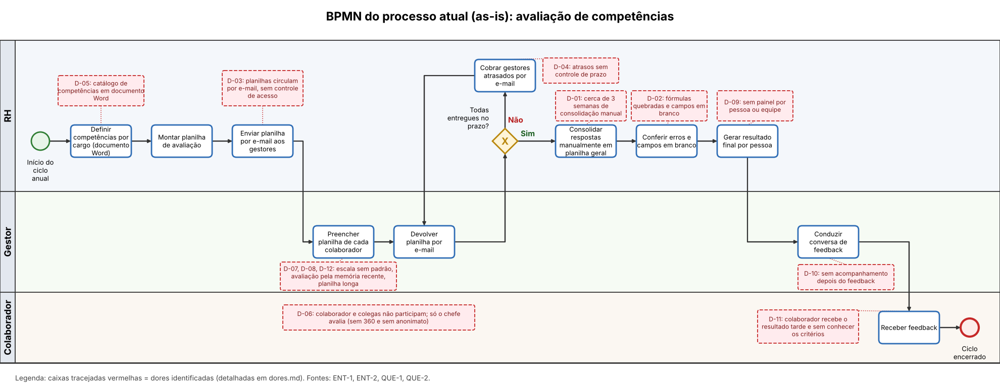
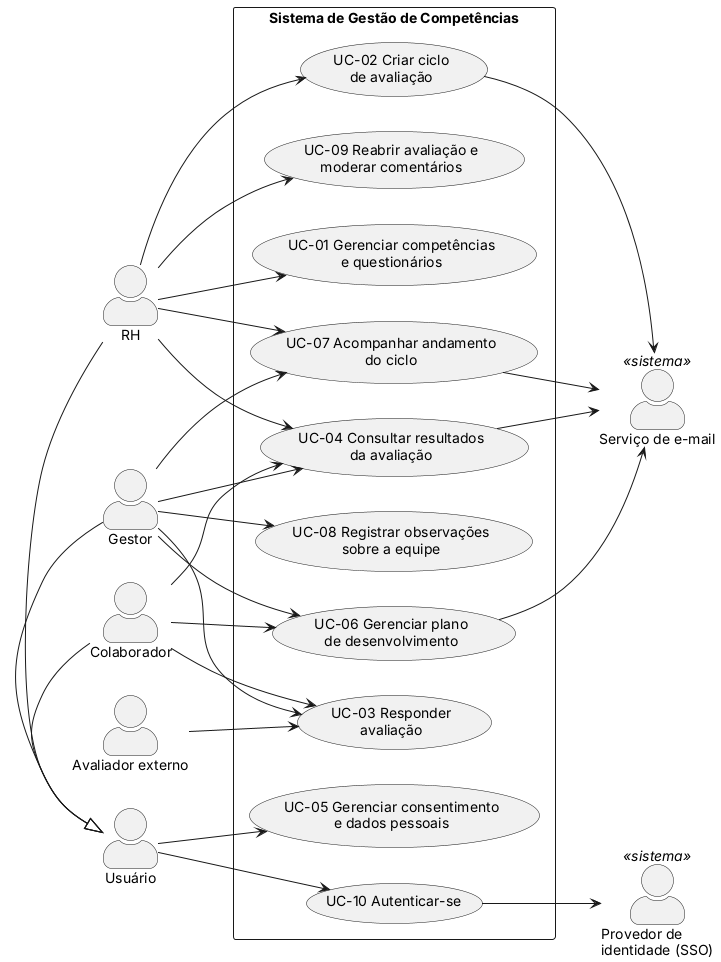

## 5. Projeto da arquitetura e desenho detalhado de componentes

Esta seção apresenta os modelos estruturais e comportamentais do modelo C4 adaptado pela disciplina, em quatro níveis.

**Tabela 5.1 — Modelos por nível do C4 adaptado**

| Nível | Modelos estruturais | Modelos comportamentais | Seção |
|------------------------|----------------------------|--------------------------------------|----------|
| 1 — Contexto | DImp | DPN (BPMN), DCdu | 5.1 |
| 2 — Containers e cenários | DPac | Casos de uso completos, PIhc | 5.2 |
| 3 — Componentes e comportamentos | DCmp, ECBD (DCD e DDC) | DSeq entre componentes | 5.3 |
| 4 — Código | EOBD, DCla | DSeq de operações, contratos de operação | 5.4 |

Fonte: adaptado do enunciado da Parte III.

### 5.1 Nível 1: modelos de contexto

#### 5.1.1 Diagrama de Implantação (DImp)

Autor: Arthur Mamedes Borges · Revisor: Gabriel Araújo Caetano · Issue: #53 · Referências: _OMG UML 2.5; Larman_

> Dica: nós de hardware e ambientes de execução (dispositivo do usuário com o browser, servidor com o proxy reverso, servidor de aplicação com o Tomcat embutido e o artefato `sgc.jar`, servidor de banco com PostgreSQL), os serviços externos (e-mail, SSO) e os **atores** ligados aos nós que usam. Indique os protocolos nas associações (HTTPS, JDBC, SMTP, OIDC/SAML). Precisa bater com a Tabela 4.1. Fonte em `diagramas/dimp-implantacao.puml`.

**Figura 5.1 — Diagrama de Implantação**

Fonte: elaborado pelos autores (2026).

_Descrição dos nós, artefatos e atores._

#### 5.1.2 Processos de negócio (DPN)

Autor: Rikelmy Andrade · Revisor: José Eduardo · Issue: #68 · Referências: OMG BPMN 2.0; _..._

> Dica: o enunciado pede o processo de **cada** processo de negócio. Reaproveite o [processo atual](../../07-bpmn) (com as dores da 1ª etapa) e modele o **processo proposto**, com o sistema apoiando o ciclo de avaliação (abertura, convites, respostas, consolidação, liberação, plano de desenvolvimento). Mostre em cada atividade automatizada o caso de uso que a realiza, e quais dores ela resolve.

**Figura 5.2 — Processo atual de avaliação de competências (com as dores)**

Fonte: elaborado pelos autores (2026), 1ª etapa.

**Figura 5.3 — Processo proposto do ciclo de avaliação com o sistema**

Fonte: elaborado pelos autores (2026).

**Tabela 5.2 — Atividades do processo proposto, casos de uso e dores resolvidas**

| Atividade | Caso de uso | Dor resolvida |
|----------------------------------------|--------------------|----------------------------------------|
| _..._ | _UC-NN_ | _..._ |

Fonte: elaborado pelos autores (2026).

#### 5.1.3 Diagrama de Casos de Uso (DCdu)

Autor: Arthur Mamedes Borges · Revisor: Lorenzo Oliveira Maciel · Issue: #53 · Referências: Larman (cap. 6)

> Dica: o diagrama do Marco 4 continua valendo. Atualize só se algum caso de uso mudar ao ser escrito por completo. Texto curto: atores e o que cada um faz; a descrição de cada ator já está no [README dos casos de uso](../../11-casos-de-uso/README.md#atores).

**Figura 5.4 — Diagrama de Casos de Uso**

Fonte: elaborado pelos autores (2026), Marco 4.
