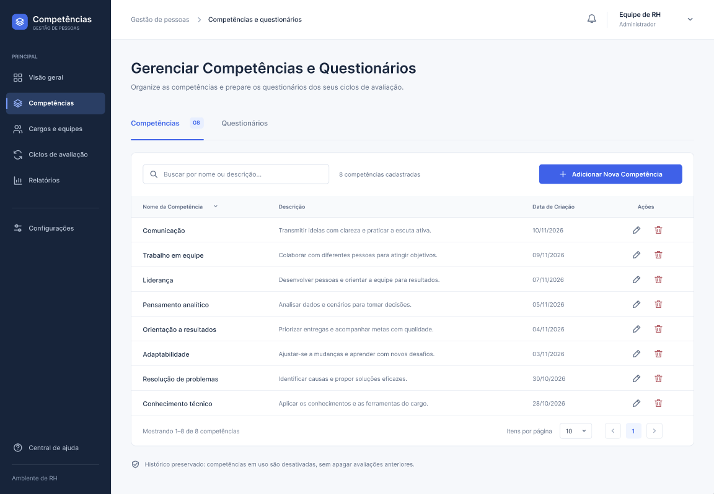
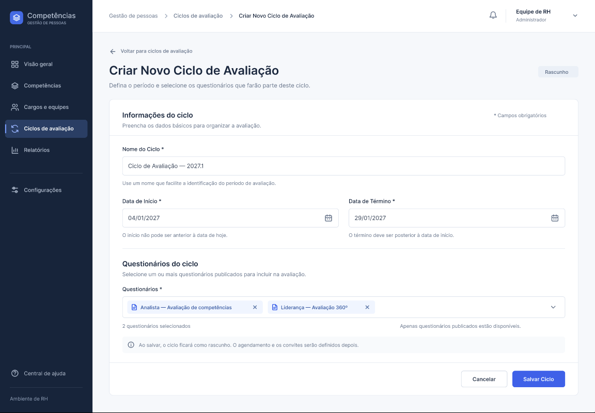
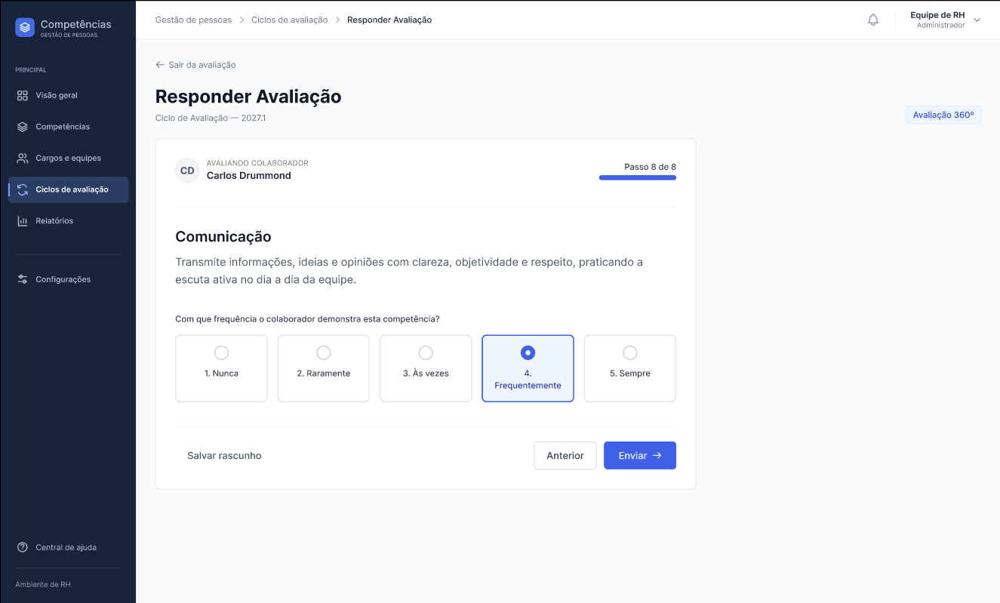
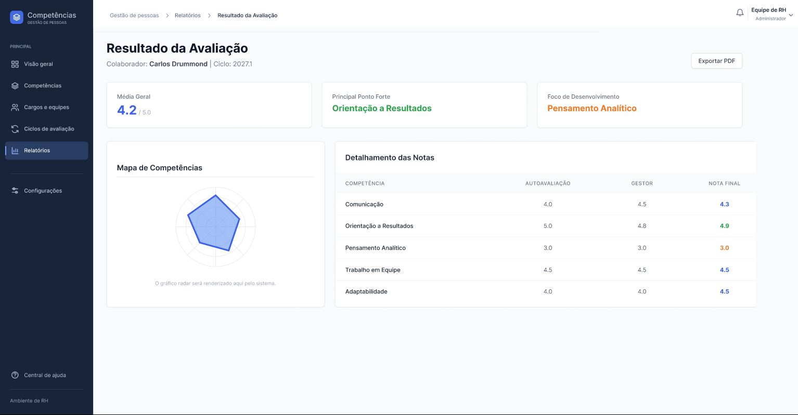
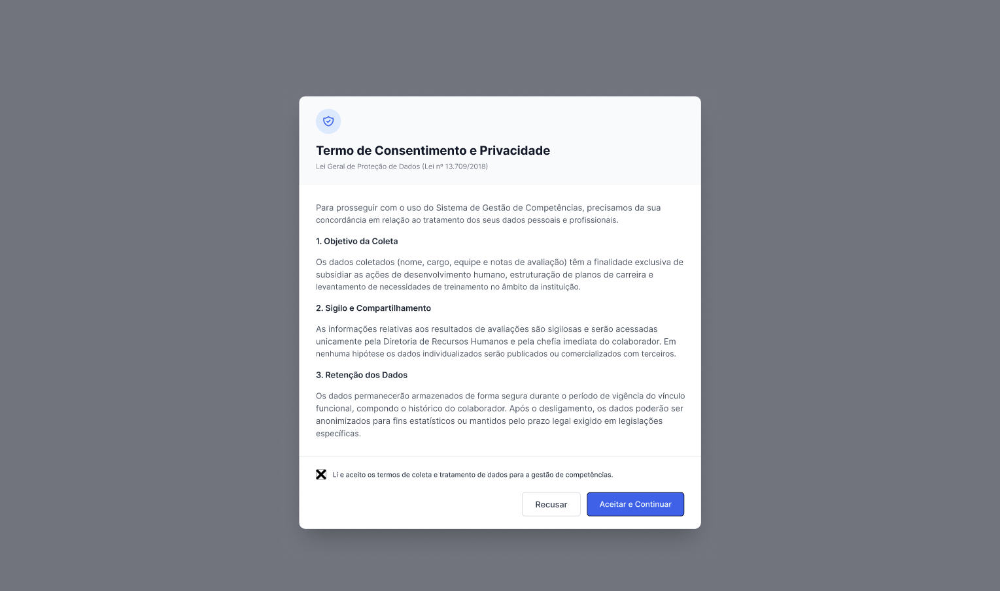

### 5.2 Nível 2: modelos de containers e cenários

#### 5.2.1 Diagrama de Pacotes (DPac)

Autor: Arthur Mamedes Borges · Revisor: José Eduardo · Issue: #53 · Referências: _OMG UML 2.5; Larman_

> Dica: os pacotes são os mesmos do código em `prototipo/src/main/java/br/edu/pucgoias/sgc/` (`identidade`, `competencias`, `ciclos`, `avaliacoes`, `resultados`, `privacidade`, `compartilhado`) e as dependências permitidas entre eles (regras do [README do protótipo](../../../prototipo/README.md#organização-do-código)). O estilo e o motivo estão em `DA-01` (seção 3.2); aqui só cite. Fonte em `diagramas/dpac-pacotes.puml`.

**Figura 5.5 — Diagrama de Pacotes**

Fonte: elaborado pelos autores (2026).

**Tabela 5.3 — Pacotes, responsabilidades e casos de uso**

| Pacote | Responsabilidade | Casos de uso | Dados persistentes | Depende de |
|----------------|--------------------------------|----------------|----------------|--------------------|
| `identidade` | _Login, perfis, usuários, cargos e equipes_ | UC-10 | Sim | `compartilhado` |
| `competencias` | _..._ | UC-01 | Sim | _..._ |
| `ciclos` | _..._ | UC-02, UC-07 | Sim | _..._ |
| `avaliacoes` | _..._ | UC-03, UC-08, UC-09 | Sim | _..._ |
| `resultados` | _..._ | UC-04, UC-06 | Sim | _..._ |
| `privacidade` | _..._ | UC-05 | Sim | _..._ |
| `compartilhado` | _Configuração, erros e log de auditoria_ | — | Sim (auditoria) | nenhum |

Fonte: elaborado pelos autores (2026).

#### 5.2.2 Casos de uso e protótipos de IHC

O enunciado pede, para **cada** caso de uso do DCdu (Figura 5.4), a descrição completa (Larman, cap. 6) e o protótipo de IHC. As descrições ficam em [`docs/11-casos-de-uso`](../../11-casos-de-uso) e as telas em [`docs/12-prototipos`](../../12-prototipos); o gerador do PDF as insere aqui.

> Dica: cada caso de uso traz no topo a ficha com autor e revisor. Depois do texto, a figura da tela (`TL-NN`) com título e fonte. As linhas `<!-- incluir: … -->` são lidas pelo `gerar-pdf.py`; não as apague.

##### UC-01 Gerenciar competências e questionários

Autor: José Eduardo · Revisor: Gabriel Araújo Caetano · Protótipo: Rikelmy Andrade (revisor: Arthur Mamedes Borges)

<!-- incluir: ../../11-casos-de-uso/UC-01-gerenciar-competencias-questionarios.md -->

**Figura 5.6 — PIhc TL-01 Gerenciar competências e questionários**

Fonte: elaborado pelos autores (2026), no Figma.

##### UC-02 Criar ciclo de avaliação

Autor: José Eduardo · Revisor: Gabriel Araújo Caetano · Protótipo: Rikelmy Andrade (revisor: Arthur Mamedes Borges)

<!-- incluir: ../../11-casos-de-uso/UC-02-criar-ciclo-avaliacao.md -->

**Figura 5.7 — PIhc TL-02 Criar ciclo de avaliação**

Fonte: elaborado pelos autores (2026), no Figma.

##### UC-03 Responder avaliação

Autor: Gabriel Araújo Caetano · Revisor: José Eduardo · Protótipo: Rikelmy Andrade (revisor: Arthur Mamedes Borges)

<!-- incluir: ../../11-casos-de-uso/UC-03-responder-avaliacao.md -->

**Figura 5.8 — PIhc TL-03 Responder avaliação**

Fonte: elaborado pelos autores (2026), no Figma.

##### UC-04 Consultar resultados da avaliação

Autor: Lorenzo Oliveira Maciel · Revisor: Arthur Mamedes Borges · Protótipo: Rikelmy Andrade (revisor: Arthur Mamedes Borges)

<!-- incluir: ../../11-casos-de-uso/UC-04-consultar-resultados.md -->

**Figura 5.9 — PIhc TL-04 Consultar resultados**

Fonte: elaborado pelos autores (2026), no Figma.

##### UC-05 Gerenciar consentimento e dados pessoais

Autor: Arthur Mamedes Borges · Revisor: Lorenzo Oliveira Maciel · Protótipo: Rikelmy Andrade (revisor: Arthur Mamedes Borges)

<!-- incluir: ../../11-casos-de-uso/UC-05-gerenciar-consentimento.md -->

**Figura 5.10 — PIhc TL-05 Gerenciar consentimento**

Fonte: elaborado pelos autores (2026), no Figma.

##### UC-06 Gerenciar plano de desenvolvimento

Autor: Lorenzo Oliveira Maciel · Revisor: Rikelmy Andrade · Issue: #69

<!-- incluir: ../../11-casos-de-uso/UC-06-gerenciar-plano-desenvolvimento.md -->

**Figura 5.11 — PIhc TL-06 Gerenciar plano de desenvolvimento**

Fonte: elaborado pelos autores (2026), no Figma.

##### UC-07 Acompanhar andamento do ciclo

Autor: José Eduardo · Revisor: Lorenzo Oliveira Maciel · Issue: #70

<!-- incluir: ../../11-casos-de-uso/UC-07-acompanhar-andamento-ciclo.md -->

**Figura 5.12 — PIhc TL-07 Acompanhar andamento do ciclo**

Fonte: elaborado pelos autores (2026), no Figma.

##### UC-08 Registrar observações sobre a equipe

Autor: Gabriel Araújo Caetano · Revisor: Arthur Mamedes Borges · Issue: #71

<!-- incluir: ../../11-casos-de-uso/UC-08-registrar-observacoes.md -->

**Figura 5.13 — PIhc TL-08 Registrar observações**

Fonte: elaborado pelos autores (2026), no Figma.

##### UC-09 Reabrir avaliação e moderar comentários

Autor: Arthur Mamedes Borges · Revisor: José Eduardo · Issue: #72

<!-- incluir: ../../11-casos-de-uso/UC-09-reabrir-avaliacao-moderar-comentarios.md -->

**Figura 5.14 — PIhc TL-09 Reabrir avaliação e moderar comentários**

Fonte: elaborado pelos autores (2026), no Figma.

##### UC-10 Autenticar-se

Autor: Rikelmy Andrade · Revisor: Gabriel Araújo Caetano · Issue: #73

<!-- incluir: ../../11-casos-de-uso/UC-10-autenticar-se.md -->

**Figura 5.15 — PIhc TL-10 Autenticar-se**

Fonte: elaborado pelos autores (2026), no Figma.
